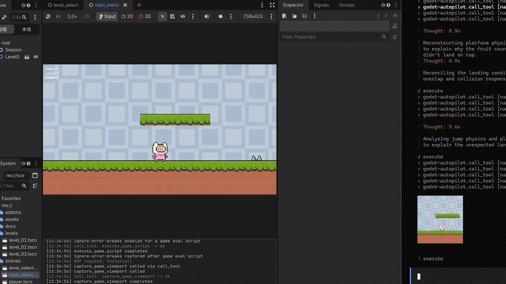

# Godot-Autopilot

[](LICENSE)
[](https://github.com/jesspig/Godot-Autopilot/actions)


[](https://modelcontextprotocol.io/)


> **AIエージェントがGodotゲームのビルド、プレイテスト、デバッグをエディターの内部から行います。**

[English](README.md) | [简体中文](README.zh-CN.md) | [繁體中文](README.zh-TW.md) | **日本語** | [한국어](README.ko.md)

Godot-Autopilotは、プラグインとして**Godotエディター内部**に常駐する[MCP](https://modelcontextprotocol.io/)サーバーです。インストールすると、AIコーディングアシスタント（Claude Code、Cursor、Codex、OpenCodeなど）がユーザーの皆様と同じようにプロジェクトを操作できます。シーンのビルド、プロパティの調整、ゲームの実行、ボタンの押下、スクリーンショットの撮影、ログの読み取りを行い、結果を見ながら反復改善します。

ブリッジプロセスも、エラーをチャット欄にコピー＆ペーストする手間も不要です。サーバーはプロジェクトを開くと起動し、閉じると停止します。

## エンドツーエンドデモ

エンドツーエンドテスト中にAIがゲームキャラクターをリアルタイムで操作している様子です：



## できること

**451以上**のツールでエディターからゲーム実行までの流れ全体をカバーしています（正確な数はバージョンごとに増えますので、`search_tools`でエージェントに確認してもらいます）。主な機能は次のとおりです：

- **シーンのビルド** — Nodeの作成、名前変更、移動、削除を行い、プロパティの読み書きやシグナルの接続、GridMapによる3Dブロックレベルの構築ができます（例：`create_scene_node`、`property_set`、`signal_connect`、`scene_tree_items`；GridMap：`create_gridmap`、`set_gridmap_cell`、`fill_gridmap_box`）。
- **見た目・音・質感** — メッシュとマテリアル、ライトと環境、オーディオ再生、アニメーションとトゥイーン、UIテーマ、タイルマップを扱えます（例：`create_animation`、`tween_editor_property`、`create_game_tween`、`play_audio_player`、`fill_tilemap_rect`）。
- **物理とナビゲーション** — レイ／形状キャスト、剛体、ナビゲーションマップと経路検索に対応します（例：`intersect_physics_3d_ray`、`create_nav_3d_map`、`get_nav_3d_map_path`）。
- **手：入力とUI自動化** — キー、マウス、ゲームパッドをシミュレートし、名前でエディターのコントロールをクリックしたり、エディターのショートカットを実行したり、実行中のゲームのボタンをクリックしたりできます（例：`click_input_mouse`、`get_editor_ui_elements`、`click_editor_element`、`run_editor_shortcut`、`click_game_ui_element`）。
- **スクリプトとデバッグ** — エディター内やゲーム内でGDScriptを実行し、長時間のゲームスクリプトをバックグラウンドジョブとして起動し、プラグイン／ゲーム／スクリプトエラーのログを読み取ります（例：`execute_script`、`execute_game_script`、`start_game_job`、`get_plugin_log`）。
- **プロジェクトと知識** — プロジェクトのファイルやディレクトリーの読み取り・検索・コピー、プロジェクト設定の確認、エンジン内蔵APIドキュメントのオフライン検索ができます（例：`read_file`、`find_in_files`、`list_directory`、`copy_file`、`get_project_settings`、`get_docs_class`）。
- **プレイと目視確認** — 現在のシーンを起動し、時間指定の入力シーケンスを投入し、エディターとゲームのスクリーンショットを撮影して変更前後を比較します（例：`play_editor_current_scene`、`queue_game_input`、`capture_editor_viewport`、`capture_game_viewport`、`review_scene_visually`）。

## エージェントの使い方

ツール名を覚える必要はありません。エージェントは次のシンプルな流れに従います：

1. **探索** — `search_tools`で候補を探し、`get_tool_detail`でパラメーターを確認します（名前を推測しません）。
2. **実行** — 単発の手順は`call_tool`、一括処理は`batch_execute`で実行します。
3. **検証** — 結果をスクリーンショットで撮影し、前回の撮影結果と比較して修正し、繰り返します。

エージェントが最初から使いこなせるように、プラグインには**スキルブック（9冊）**（概要編、呼び出しガイド編、さらにシーン編・リソース編・スクリプト編・ランタイム編・サーバー編・コンテンツ編・C#編）と**スターターガイド（7本）**（3Dシーン、キャラクターコントローラー、物理デバッグ、入力マップ、GUIなど）が付属します。**MCP Config**パネルでワンクリックすると、プロジェクトの`.agents/skills/`にスキルが生成されます。位置づけとして、MCPが主要な製品チャネルであり、スキル／スクリプトは体験層です。呼び出しガイドは、MCPが停止した場合はスクリプトブリッジに切り替わり（Node 18+またはBunが必要です）、スクリプト実行環境がない場合は手順書に切り替わります。

プラグインには2つのエディターパネルが付属します：

- **MCP Config** — サーバーの状態とポート、ワンクリックでのクライアント設定、機能スイッチ、スキル生成を行います。
- **Log** — プラグイン専用ログをレベル／カテゴリーフィルターと検索付きで表示しますので、異常な呼び出しを追跡しやすくなります。

## はじめに

**Godot 4.7+**が必要です。

1. **プラグインの入手** — プロジェクトのGitHub Releasesページ（[jesspig/Godot-Autopilot](https://github.com/jesspig/Godot-Autopilot)）から`addons.zip`をダウンロードし、`godot-autopilot/`フォルダーをプロジェクトの`addons/`ディレクトリーにコピーします：
    ```
    your-project/
    └── addons/
        └── godot-autopilot/
            ├── godot-autopilot.dll      (Windows)
            ├── libgodot-autopilot.so    (Linux)
            ├── libgodot-autopilot.dylib (macOS)
            └── godot-autopilot.gdextension
    ```
2. **プロジェクトを開きます** — プラグイン設定のポートでサーバーが自動的に起動します（既定値は`http://127.0.0.1:9527/mcp`）。有効化スイッチは不要です。
3. **AIクライアントを接続します** — エディターの**MCP Config**パネルでクライアントを選び、**Generate**をクリックします。Claude Code、Codex、Cursor、OpenCode、Copilotを含む20のクライアントに対応しています。確認を求められたら、生成された設定ファイルをクライアント側で承認します。
4. **強力な機能を有効化します（任意）** — スクリプト実行（`code_execute`）とゲーム制御（`game_runtime`）は既定で無効です。必要なときにパネルでチェックを入れます。
5. **お願いしてみます** — 例：「走ってジャンプできるプレイヤーキャラクターを作って、プレイテストして変なところを直して」。

ソースからビルドしたり貢献したりしたい場合は、[docs/wiki/](docs/wiki/)（まずは[index.md](docs/wiki/index.md)、ビルドは[build.md](docs/wiki/build.md)）と[tests/README.md](tests/README.md)をご覧ください。

## コマンドラインからの利用

チャットクライアントではなくターミナルから操作したいですか？GDA CLI は実行中の GDA インスタンスをシェルから操作します。MCPクライアントの統合は不要です。Bun + TypeScript 製で、ソースから直接実行でき、**実行時依存関係ゼロ**、ビルド手順もありません。

`bunx` でその場実行します（PowerShell では `#` がコメント開始になるため引用符が必要です）：

```
bunx "github:jesspig/Godot-Autopilot#0.2.7" ping
```

または一度グローバルインストールして、`gda` コマンドを使います：

```
bun install -g github:jesspig/Godot-Autopilot#0.2.7
gda ping
```

コマンドファミリー：**呼び出し系** — `ping` / `status` / `categories` / `search` / `describe` / `call`；**ライフサイクル** — `list` / `start` / `stop` / `logs`。

**Bun** が必要です。Bun も Node も無い環境では、Releases の `gda` 単体バイナリを使ってください（詳細は [docs/wiki/modules/cli.md](docs/wiki/modules/cli.md)）。

## AI にセットアップさせる

上の手順を手作業でなぞる代わりに、同じマシンでシェルを実行できるコーディングエージェントに任せられます。下のブロックをコピーし、プロジェクトの絶対パスを埋めて送ってください：

```text
Set up Godot Autopilot (GDA) on this machine end to end, then prove it works.

Project: <ABSOLUTE PATH TO YOUR GODOT PROJECT> (Godot 4.7+).

1. Install the plugin: download addons.zip from
   https://github.com/jesspig/Godot-Autopilot/releases/latest and extract it so that
   <project>/addons/godot-autopilot/godot-autopilot.gdextension exists.
2. Start the editor: run `godot --editor --path <project>` (ask me for the engine path if it is
   not on PATH) and wait until http://127.0.0.1:9527/mcp answers.
3. Verify the server from a shell. Try in this order, stop at the first that works, and tell me
   which one it was:
   - bunx "github:jesspig/Godot-Autopilot#0.2.7" ping
   - download the gda release asset for this OS and CPU from the same Releases page, verify it
     against sha256sums.txt, then run ./gda ping
4. Connect my AI client: add
   {"mcpServers":{"godot-autopilot":{"url":"http://127.0.0.1:9527/mcp"}}}
   to its MCP configuration, or tell me to use the plugin's MCP Config panel instead.
5. Summarize: which channel worked, every command you ran, and anything that failed.

Rules: never hand-write HTTP requests against the port; never expose 9527 beyond loopback;
leave code_execute and game_runtime disabled unless I ask for them.
```

クライアントがスキルに対応している場合（Claude Code、Codex、Cursor など）は、このリポジトリの `skills/` ディレクトリも指定してください。エージェントが推測せずに完全な呼び出しプロトコルを参照できます。

## 安全上の注意

サーバーはお使いのマシンのループバックアドレス上でのみ待ち受けます（プラグイン設定のポート、既定では9527、パスは`/mcp`固定）。ローカル外のアドレスは拒否します。スクリプト実行、ゲーム制御、OSプロセスのツールは**既定で拒否**されます。信頼できるローカルプロジェクトでのみ有効化します。詳細は[docs/wiki/security_contract.md](docs/wiki/security_contract.md)をご覧ください。

## アセットの帰属

`demo/`配下の5つのサンプルプロジェクト（2D／3D初心者向けチュートリアル、UIコントロールギャラリー、ビューポート構成、ネットワーク対戦Pong）は公式の[Godotデモプロジェクト](https://github.com/godotengine/godot-demo-projects)が由来です。テスト用にアセットとクリーンなプロジェクト構成のみを残しています。著作権とライセンスの詳細は各プロジェクトのREADMEとLICENSEファイルに記載されています。

## ライセンス

MIT
