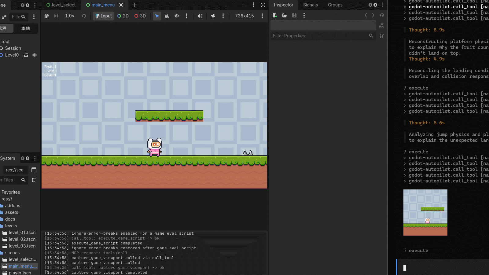

# Godot Autopilot

[](LICENSE)
[](https://github.com/jesspig/Godot-Autopilot/releases)
[](https://github.com/jesspig/Godot-Autopilot/actions)
[](https://github.com/jesspig/Godot-Autopilot/actions/workflows/release.yml)


[](https://modelcontextprotocol.io/)


> **AIエージェントがGodotゲームのビルド、プレイテスト、デバッグをエディターの内部から行います。**

[English](README.md) | [简体中文](README.zh-CN.md) | [繁體中文](README.zh-TW.md) | **日本語** | [한국어](README.ko.md)

> 本翻訳は英語版 [README.md](README.md) を正とします。

Godot Autopilot (GDA) は、プラグインとして**Godot エディターの内部**に常駐する [MCP](https://modelcontextprotocol.io/) サーバーです。インストールすると、AI コーディングアシスタント（Claude Code、Cursor、Codex、OpenCode など）がユーザーと同じようにプロジェクトを操作できます。シーンの構築、プロパティの調整、ゲームの実行、ボタンの押下、スクリーンショットの撮影、ログの読み取りを行い、その結果を見ながら反復改善します。ブリッジプロセスも、エラーをチャット欄にコピー＆ペーストする手間も不要です。グラフィカルなエディターセッションでは、サーバーはプロジェクトを開くと起動し、閉じると停止します。



**252 個のツール**がエディターからゲーム実行までのループ全体をカバーします：246 個のドメインツール、5 個のメタツール、`system_status`（正確な数はバージョンごとに増えます。`search_tools` でエージェントに確認してください）。325 個の旧ツール名エイリアスは 0.6.0 まで `call_tool` で呼び出せます（実名ツールと重複する場合は実名ツールが優先）。スキルブックは **入口カード 1 枚と references 9 篇**で、呼び出しプロトコルをエージェントに教えます。MCP が停止している場合は GDA CLI へフォールバックします。参考：[ツール面](docs/wiki/tool_surface_baseline.md)、[スキル](docs/wiki/modules/skills.md)、[CLI](docs/wiki/modules/cli.md)。

## クイックスタート

**Godot 4.7+** とグラフィカルなエディターセッションが必要です。

1. **インストール** — Godot プロジェクトのルートでワンクリックスクリプトを実行するか、手動でのリリースインストールとソースビルドの手順については [INSTALL.md](INSTALL.md) に従ってください。
   - macOS/Linux:

     ```bash
     curl -fsSL https://raw.githubusercontent.com/jesspig/Godot-Autopilot/master/scripts/install.sh \
       | bash -s -- --project "$PWD" --skills
     ```

   - Windows PowerShell:

     ```powershell
     & ([scriptblock]::Create((irm https://raw.githubusercontent.com/jesspig/Godot-Autopilot/master/scripts/install.ps1))) `
       -Project (Get-Location).Path -Skills
     ```

   スクリプトは `gda` CLI をインストールし、`project.godot` を検出してプラグインをインストールし、必要に応じてスキルブックもインストールします。
2. **プロジェクトを開く** — グラフィカルなエディターセッションでは、サーバーが自動的に起動し、初回起動時に空いているループバックポートをバインドします（プロジェクトごとに永続化され、`20000–29999` から選択）。ヘッドレス／コマンドラインのエディターセッションではサーバーは起動しません。
3. **AIクライアントを接続する** — `gda status --json` を実行し、その `mcp_url` をクライアントの MCP 設定に追加します（または URL をエージェントに渡して設定を生成させます）。Streamable HTTP をサポートする MCP クライアントであれば接続できます。例として Claude Code、Codex、Cursor、OpenCode、Copilot などがあります。
4. **何かを作ってもらう** — 例：「走ってジャンプできるプレイヤーキャラクターを作って、プレイテストして、おかしいところを直して」。

## 安全上の注意

サーバーは、お使いのマシンのループバックアドレス上でのみ待ち受け（プラグインがプロジェクトごとに選択するポート、パスは `/mcp` 固定）、ローカル以外のアドレスを拒否します。高リスクツール（`destructive`、`process`、`code_execute`、`game_runtime`）には `confirm=true` が必要です。グローバルな許可リストはありません。詳細：[docs/wiki/security_contract.md](docs/wiki/security_contract.md)。

## ドキュメント

- [INSTALL.md](INSTALL.md) — ワンクリックスクリプト、手動でのリリースインストール、ソースビルド、エージェント向けの手順。
- [docs/wiki/index.md](docs/wiki/index.md) — プロジェクトの知識ベース：アーキテクチャ、モジュール、テスト、規約。
- [docs/wiki/tool_surface_baseline.md](docs/wiki/tool_surface_baseline.md) — ツール面、エイリアス、schema、ケイパビリティ行列のベースライン。
- [docs/wiki/build.md](docs/wiki/build.md) — ビルド、デプロイ、パッケージング。
- [docs/wiki/modules/cli.md](docs/wiki/modules/cli.md) — CLI の完全なリファレンス。
- [docs/wiki/modules/skills.md](docs/wiki/modules/skills.md) — スキルブックと `gda install skills`。
- [tests/README.md](tests/README.md) — テストの構成とコマンド。

## ライセンス

MIT
