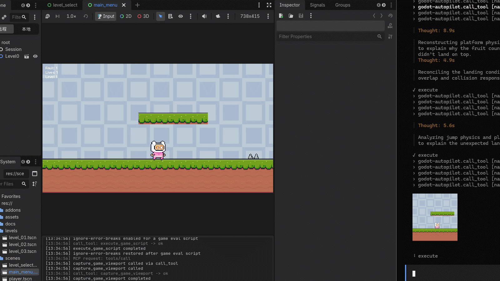

# Godot Autopilot

[](LICENSE)
[](https://github.com/jesspig/Godot-Autopilot/actions)


[](https://modelcontextprotocol.io/)


> **AIエージェントがGodotゲームのビルド、プレイテスト、デバッグをエディターの内部から行います。**

[English](README.md) | [简体中文](README.zh-CN.md) | [繁體中文](README.zh-TW.md) | **日本語** | [한국어](README.ko.md)

Godot Autopilot (GDA) は、プラグインとして**Godotエディターの内部**に常駐する [MCP](https://modelcontextprotocol.io/) サーバーです。インストールすると、AIコーディングアシスタント（Claude Code、Cursor、Codex、OpenCode など）が、ユーザーと同じようにプロジェクトを操作できるようになります。シーンの構築、プロパティの調整、ゲームの実行、ボタンの押下、スクリーンショットの撮影、ログの読み取りを行い、その結果を見ながら反復改善します。

ブリッジプロセスも、エラーをチャット欄にコピー＆ペーストする手間も不要です。グラフィカルなエディターセッションでは、サーバーはプロジェクトを開くと起動し、閉じると停止します。

## エンドツーエンドデモ

エンドツーエンドテスト中に、AIがゲームキャラクターをリアルタイムで操作している様子：



## できること

エディターからゲーム実行までのループ全体をカバーする **452以上のツール** を備えています（正確な数はバージョンごとに増えていきます。`search_tools` でエージェントに確認してください）。主な機能は次のとおりです：

- **シーンの構築** — ノードの作成、名前変更、移動、削除、プロパティの読み書き、シグナルの接続、GridMap による 3D ブロックレベルの構築ができます（例：`create_scene_node`、`property_set`、`signal_connect`、`scene_tree_items`；GridMap：`create_gridmap`、`set_gridmap_cell`、`fill_gridmap_box`）。
- **見た目・サウンド・操作感** — メッシュとマテリアル、ライトと環境、オーディオ再生、アニメーションとトゥイーン、UIテーマ、タイルマップを扱えます（例：`create_animation`、`tween_editor_property`、`create_game_tween`、`play_audio_player`、`fill_tilemap_rect`）。
- **物理とナビゲーション** — レイ／シェイプキャスト、リジッドボディ、ナビゲーションマップと経路クエリ（例：`intersect_physics_3d_ray`、`create_nav_3d_map`、`get_nav_3d_map_path`）。
- **手を動かす：入力とUIの自動化** — キー、マウス、ゲームパッドのシミュレート、エディターコントロールの名前指定クリック、エディターショートカットの実行、実行中のゲーム内ボタンのクリックができます（例：`click_input_mouse`、`get_editor_ui_elements`、`click_editor_element`、`run_editor_shortcut`、`click_game_ui_element`）。
- **スクリプトとデバッグ** — エディター内またはゲーム内での GDScript の実行、長時間実行するゲームスクリプトのバックグラウンドジョブとしての起動、プラグイン／ゲーム／スクリプトエラーのログの読み取りができます（例：`execute_script`、`execute_game_script`、`start_game_job`、`get_plugin_log`）。
- **プロジェクトと知識** — プロジェクトのファイルとディレクトリーの読み取り・検索・コピー、プロジェクト設定の確認、エンジン内蔵 API ドキュメントのオフライン検索ができます（例：`read_file`、`find_in_files`、`list_directory`、`copy_file`、`get_project_settings`、`get_docs_class`）。
- **プレイと目視による検証** — 現在のシーンの起動、タイミングを指定した入力シーケンスの注入、エディターとゲームのスクリーンショット撮影、変更前後の差分比較ができます（例：`play_editor_current_scene`、`queue_game_input`、`capture_editor_viewport`、`capture_game_viewport`、`review_scene_visually`）。

## クイックスタート

**Godot 4.7+** とグラフィカルなエディターセッションが必要です。

1. **インストール** — Godot プロジェクトのルートでワンクリックスクリプトを実行するか、手動でのリリースインストールとソースビルドの手順については [INSTALL.md](INSTALL.md) に従ってください。
   - macOS/Linux:
     ```bash
     curl -fsSL https://raw.githubusercontent.com/jesspig/Godot-Autopilot/master/scripts/install.sh \
       | bash -s -- --project "$PWD" --skills
     ```
   - Windows PowerShell:
     ```powershell
     & ([scriptblock]::Create((irm https://raw.githubusercontent.com/jesspig/Godot-Autopilot/master/scripts/install.ps1))) `
       -Project (Get-Location).Path -Skills
     ```
   スクリプトは `gda` CLI をインストールし、`project.godot` を検出してプラグインをインストールし、必要に応じてスキルブックもインストールします。
2. **プロジェクトを開く** — グラフィカルなエディターセッションでは、サーバーが自動的に起動し、初回起動時に空いているループバックポートをバインドします（プロジェクトごとに永続化され、`20000–29999` から選択）。ヘッドレス／コマンドラインのエディターセッションではサーバーは起動しません。
3. **AIクライアントを接続する** — `gda status --json` を実行し、その `mcp_url` をクライアントの MCP 設定に追加します（または URL をエージェントに渡して設定を生成させます）。Streamable HTTP をサポートする MCP クライアントであれば接続できます。例として Claude Code、Codex、Cursor、OpenCode、Copilot などがあります。
4. **何かを作ってもらう** — 例：「走ってジャンプできるプレイヤーキャラクターを作って、プレイテストして、おかしいところを直して」。

高リスクツール（`destructive`、`process`、`code_execute`、`game_runtime`）には `confirm=true` が必要です。グローバルな許可リストはありません。

## AIエージェントを使ったインストール

同じマシンでシェルを実行できるエージェントに、次を送信してください：

```text
Read https://github.com/jesspig/Godot-Autopilot/blob/master/INSTALL.md and install it.
```

エージェントは Godot プロジェクトを特定し、CLI とプラグインをインストールし、スキルブックをグローバルに置くかプロジェクト専用にするかを確認し、`gda status --json` で接続を検証して、MCP URL を報告します。エージェント向けの完全なルールは [INSTALL.md](INSTALL.md) にあります。

## スキルブック

プラグインには **10冊の自己完結したスキルブック**（概要編に加え、シーン編・リソース編・スクリプティング編・ランタイム編・サーバー編・コンテンツ編・C#編・セットアップ編・ツール編）が付属しています。次のいずれか1つのスコープでインストールします：

```bash
# Global: shared by all Godot projects
gda install skills

# Project-only: kept with this project
gda install skills --path "<project>/.agents/skills"

# Chinese editions
gda install skills --zh
gda install skills --path "<project>/.agents/skills" --zh
```

デフォルトのインストール先は `~/.agents/skills` です。このディレクトリーを読み込まないクライアントでは、`--path <client-skills-dir>` を使用できます。スキルブックは、エージェントを場当たり的な操作に任せず、呼び出しプロトコルを教えます。位置づけとして、MCP は主要な製品チャネルであり、スキルは体験レイヤーです。呼び出しガイドは、MCP が停止している場合に GDA CLI へフォールバックします。

プラグインにはエディターパネルが1つ付属しています：

- **Log** — プラグイン専用のログ。レベル／カテゴリーフィルターと検索を備え、問題のある呼び出しを追跡しやすくします。

## エージェントの操作方法

ツール名を覚える必要はありません。エージェントはシンプルなループに従います：

1. **探索** — `search_tools` で候補を探し、`get_tool_detail` でパラメーターを確認します（名前を推測しないでください）。
2. **実行** — 1ステップなら `call_tool`、まとめて実行するなら `batch_execute` を使用します。
3. **検証** — 結果をスクリーンショットに撮り、前回のキャプチャと比較し、修正して繰り返します。

## コマンドラインからのアクセス

チャットクライアントよりもターミナルを使いたいですか？GDA CLI は、シェルから実行中の GDA インスタンスを操作します。MCP クライアントの統合は不要です。Bun + TypeScript 製で、ソースから実行でき、**実行時依存関係はゼロ**、ビルド手順もありません。

`bunx` で単発実行できます（PowerShell では `#` がコメントの開始になるため、引用符で囲みます）：

```bash
bunx "github:jesspig/Godot-Autopilot#0.3.3" ping
```

または一度グローバルにインストールして、`gda` コマンドを使用します：

```bash
bun install -g github:jesspig/Godot-Autopilot#0.3.3
gda ping
```

コマンドファミリー：**呼び出し** — `ping` / `status` / `categories` / `search` / `describe` / `call`；**ライフサイクル** — `list` / `start` / `stop` / `restart` / `logs`；**オフラインとアセット** — `skills` / `tools` / `projects` / `cache` / `install` / `update` / `trace`。

**Bun** が必要です。Bun も Node もないマシンでは、代わりに Releases ページのスタンドアロン `gda` バイナリを使用してください（完全なリファレンスは [docs/wiki/modules/cli.md](docs/wiki/modules/cli.md) を参照）。

## 安全上の注意

サーバーは、お使いのマシンのループバックアドレス上でのみ待ち受け（プラグインがプロジェクトごとに選択するポート、パスは `/mcp` 固定）、ローカル以外のアドレスを拒否します。高リスクツール（`destructive`、`process`、`code_execute`、`game_runtime`）には `confirm=true` が必要です。グローバルな許可リストはありません。詳細：[docs/wiki/security_contract.md](docs/wiki/security_contract.md)。

## ドキュメント

- [INSTALL.md](INSTALL.md) — ワンクリックスクリプト、手動でのリリースインストール、ソースビルド、エージェント向けの手順。
- [docs/wiki/index.md](docs/wiki/index.md) — プロジェクトの知識ベース：アーキテクチャ、モジュール、テスト、規約。
- [docs/wiki/build.md](docs/wiki/build.md) — ビルド、デプロイ、パッケージング。
- [docs/wiki/modules/cli.md](docs/wiki/modules/cli.md) — CLI の完全なリファレンス。
- [tests/README.md](tests/README.md) — テストの構成とコマンド。

## アセットの帰属

`examples/` 配下の5つのサンプルプロジェクト（2D／3D 初心者向けチュートリアル、UIコントロールギャラリー、ビューポート合成、ネットワーク対戦 Pong）は、公式の [Godot デモプロジェクト](https://github.com/godotengine/godot-demo-projects) に由来します。テスト用に、各プロジェクトのアセットとクリーンなプロジェクト設定のみを残しています。6つ目のプロジェクト `examples/pink_man_adventure` は、過去の `Example/` デモプロジェクトから復元されたリポジトリ内のサンプルです。173枚の PNG アセットは Pixel Frog の Pixel Adventure 1（CC0 1.0）に由来し、設計ドキュメントはこのリポジトリのオリジナルです。著作権とライセンスの詳細は、各プロジェクトの README と LICENSE ファイルに記載されています。

## ライセンス

MIT
