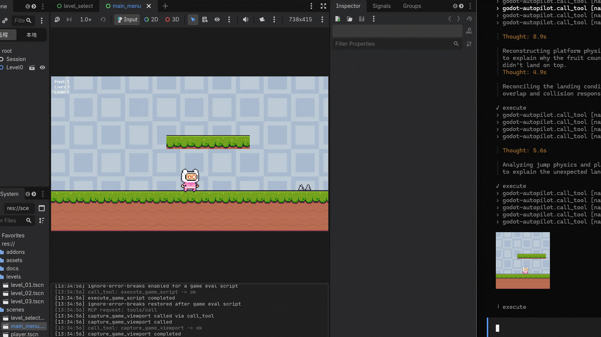

# Godot Autopilot

[](LICENSE)
[](https://github.com/jesspig/Godot-Autopilot/actions)


[](https://modelcontextprotocol.io/)


> **AI 에이전트가 에디터 안에서 Godot 게임을 빌드하고, 플레이테스트하고, 디버깅하게 하세요.**

[English](README.md) | [简体中文](README.zh-CN.md) | [繁體中文](README.zh-TW.md) | [日本語](README.ja.md) | **한국어**

Godot Autopilot(GDA)은 **Godot 에디터 내부**에 플러그인으로 상주하는 [MCP](https://modelcontextprotocol.io/) 서버입니다. 설치하고 나면 AI 코딩 어시스턴트(Claude Code, Cursor, Codex, OpenCode 등)가 사용자와 똑같은 방식으로 프로젝트를 다룰 수 있습니다. 씬을 만들고, 속성을 조정하고, 게임을 실행하고, 버튼을 누르고, 스크린샷을 찍고, 로그를 읽은 다음, 확인한 내용을 바탕으로 계속 반복 개선합니다.

브리지 프로세스도 없고, 오류를 채팅창에 복사해 붙여넣을 필요도 없습니다. 그래픽 에디터 세션에서는 프로젝트를 열면 서버가 시작되고, 프로젝트를 닫으면 서버가 중지됩니다.

## 엔드투엔드 데모

엔드투엔드 테스트 중 AI가 게임 캐릭터를 실시간으로 조작하는 모습:



## 할 수 있는 일

**452개 이상의 도구**가 에디터에서 게임까지 이어지는 전체 루프를 아우릅니다(정확한 개수는 버전마다 늘어나므로, `search_tools`로 에이전트에게 확인하도록 요청하세요). 주요 기능:

- **씬 빌드** — 노드를 생성, 이름 변경, 이동, 삭제하고 속성을 읽고 씁니다. 시그널을 연결하고 GridMap으로 3D 블록 레벨을 만듭니다(예: `create_scene_node`, `property_set`, `signal_connect`, `scene_tree_items`; GridMap: `create_gridmap`, `set_gridmap_cell`, `fill_gridmap_box`).
- **비주얼, 사운드, 감각** — 메시와 머티리얼, 조명과 환경, 오디오 재생, 애니메이션과 트윈, UI 테마, 타일맵(예: `create_animation`, `tween_editor_property`, `create_game_tween`, `play_audio_player`, `fill_tilemap_rect`).
- **물리와 내비게이션** — 레이/셰이프 캐스트, 리지드 바디, 내비게이션 맵과 경로 조회(예: `intersect_physics_3d_ray`, `create_nav_3d_map`, `get_nav_3d_map_path`).
- **손: 입력과 UI 자동화** — 키, 마우스, 게임패드를 시뮬레이션하고, 이름으로 에디터 컨트롤을 클릭하고, 에디터 단축키를 실행하고, 실행 중인 게임의 버튼을 클릭합니다(예: `click_input_mouse`, `get_editor_ui_elements`, `click_editor_element`, `run_editor_shortcut`, `click_game_ui_element`).
- **스크립트와 디버깅** — 에디터 또는 게임에서 GDScript를 실행하고, 오래 걸리는 게임 스크립트를 백그라운드 작업으로 실행하고, 플러그인/게임/스크립트 오류 로그를 읽습니다(예: `execute_script`, `execute_game_script`, `start_game_job`, `get_plugin_log`).
- **프로젝트와 지식** — 프로젝트 파일과 디렉터리를 읽고, 검색하고, 복사하며, 프로젝트 설정을 확인하고, 엔진 내장 API 문서를 오프라인으로 조회합니다(예: `read_file`, `find_in_files`, `list_directory`, `copy_file`, `get_project_settings`, `get_docs_class`).
- **플레이와 시각적 검증** — 현재 씬을 실행하고, 시간 지정 입력 시퀀스를 주입하고, 에디터와 게임의 스크린샷을 찍고 전후 차이를 비교합니다(예: `play_editor_current_scene`, `queue_game_input`, `capture_editor_viewport`, `capture_game_viewport`, `review_scene_visually`).

## 빠른 시작

**Godot 4.7+**와 그래픽 에디터 세션이 필요합니다.

1. **설치** — Godot 프로젝트 루트에서 원클릭 스크립트를 실행하거나, 수동 릴리스 설치 및 소스 빌드 경로는 [INSTALL.md](INSTALL.md)를 따르세요.
   - macOS/Linux:
     ```bash
     curl -fsSL https://raw.githubusercontent.com/jesspig/Godot-Autopilot/master/scripts/install.sh \
       | bash -s -- --project "$PWD" --skills
     ```
   - Windows PowerShell:
     ```powershell
     & ([scriptblock]::Create((irm https://raw.githubusercontent.com/jesspig/Godot-Autopilot/master/scripts/install.ps1))) `
       -Project (Get-Location).Path -Skills
     ```
   스크립트는 `gda` CLI를 설치하고, `project.godot`을 감지하고, 플러그인을 설치하며, 선택적으로 스킬북을 설치합니다.
2. **프로젝트 열기** — 그래픽 에디터 세션에서는 서버가 자동으로 시작되고, 최초 실행 시 빈 루프백 포트를 하나 바인딩합니다(프로젝트별로 유지되며 `20000–29999`에서 선택). 헤드리스/커맨드라인 에디터 세션에서는 서버가 시작되지 않습니다.
3. **AI 클라이언트 연결** — `gda status --json`을 실행하고 그 `mcp_url`을 클라이언트의 MCP 설정에 추가하세요(또는 URL을 에이전트에게 넘기고 설정을 생성해 달라고 요청하세요). Streamable HTTP를 지원하는 MCP 클라이언트라면 무엇이든 연결할 수 있으며, Claude Code, Codex, Cursor, OpenCode, Copilot 등이 대표적입니다.
4. **요청하기** — 예: “달리고 점프할 수 있는 플레이어 캐릭터를 만들고, 플레이테스트한 뒤 이상해 보이는 부분을 고쳐 줘.”

고위험 도구(`destructive`, `process`, `code_execute`, `game_runtime`)는 `confirm=true`가 필요하며, 전역 허용 목록은 없습니다.

## AI 에이전트로 설치하기

같은 머신에서 셸에 접근할 수 있는 에이전트에게 다음을 보내세요:

```text
Read https://github.com/jesspig/Godot-Autopilot/blob/master/INSTALL.md and install it.
```

에이전트는 Godot 프로젝트를 찾아내고, CLI와 플러그인을 설치하고, 스킬북을 전역으로 설치할지 프로젝트에만 설치할지 물어본 뒤, `gda status --json`으로 연결을 검증하고 MCP URL을 보고합니다. 전체 에이전트 규칙은 [INSTALL.md](INSTALL.md)에 있습니다.

## 스킬북

플러그인에는 **자체 완결형 스킬북 10권**(개요, 그리고 씬, 리소스, 스크립팅, 런타임, 서버, 콘텐츠, C#, 설정, 도구 편)이 포함됩니다. 범위를 하나 골라 설치하세요:

```bash
# Global: shared by all Godot projects
gda install skills

# Project-only: kept with this project
gda install skills --path "<project>/.agents/skills"

# Chinese editions
gda install skills --zh
gda install skills --path "<project>/.agents/skills" --zh
```

기본 대상은 `~/.agents/skills`입니다. 해당 디렉터리를 읽지 않는 클라이언트는 `--path <client-skills-dir>`를 사용할 수 있습니다. 스킬북은 에이전트가 즉흥적으로 처리하지 않도록 호출 프로토콜을 가르칩니다. 포지셔닝: MCP가 주 제품 채널이고, 스킬은 경험 계층이며, 호출 가이드는 MCP가 중단되었을 때 GDA CLI로 대체됩니다.

플러그인에는 에디터 패널이 하나 포함됩니다:

- **Log** — 레벨/분류 필터와 검색을 지원하는 플러그인 전용 로그로, 잘못 동작하는 호출을 쉽게 추적할 수 있습니다.

## 에이전트의 작업 방식

도구 이름을 외울 필요가 없습니다. 에이전트는 간단한 루프를 따릅니다:

1. **탐색** — `search_tools`로 후보를 찾고, `get_tool_detail`로 매개변수를 확인합니다(이름을 절대 추측하지 않습니다).
2. **실행** — 한 단계에는 `call_tool`, 일괄 처리에는 `batch_execute`를 사용합니다.
3. **검증** — 결과를 스크린샷으로 남기고, 직전 캡처와 비교하고, 수정한 뒤 반복합니다.

## 명령줄 접근

채팅 클라이언트보다 터미널이 편하신가요? GDA CLI는 실행 중인 GDA 인스턴스를 셸에서 조작합니다. MCP 클라이언트 통합이 필요하지 않습니다. Bun + TypeScript로 작성되어 소스에서 바로 실행되며, **런타임 의존성이 전혀 없고** 빌드 단계도 없습니다.

`bunx`로 한 번만 실행하려면 다음과 같이 하세요(PowerShell에서는 `#`이 주석을 시작하므로 따옴표로 감쌉니다):

```bash
bunx "github:jesspig/Godot-Autopilot#0.3.3" ping
```

또는 한 번 전역 설치한 뒤 `gda` 명령을 사용하세요:

```bash
bun install -g github:jesspig/Godot-Autopilot#0.3.3
gda ping
```

명령 계열: **호출** — `ping` / `status` / `categories` / `search` / `describe` / `call`; **수명 주기** — `list` / `start` / `stop` / `restart` / `logs`; **오프라인 및 에셋** — `skills` / `tools` / `projects` / `cache` / `install` / `update` / `trace`.

**Bun**이 필요합니다. Bun이나 Node가 없는 머신에서는 Releases 페이지의 독립 실행형 `gda` 바이너리를 대신 사용하세요(전체 레퍼런스는 [docs/wiki/modules/cli.md](docs/wiki/modules/cli.md) 참조).

## 안전 참고 사항

서버는 머신의 루프백 주소에서만 수신 대기하며(포트는 플러그인이 프로젝트별로 선택하고 경로는 `/mcp`로 고정), 로컬이 아닌 주소는 거부합니다. 고위험 도구(`destructive`, `process`, `code_execute`, `game_runtime`)는 `confirm=true`가 필요하며, 전역 허용 목록은 없습니다. 자세한 내용: [docs/wiki/security_contract.md](docs/wiki/security_contract.md).

## 문서

- [INSTALL.md](INSTALL.md) — 원클릭 스크립트, 수동 릴리스 설치, 소스 빌드, 에이전트 지침.
- [docs/wiki/index.md](docs/wiki/index.md) — 프로젝트 지식 베이스: 아키텍처, 모듈, 테스트, 규칙.
- [docs/wiki/build.md](docs/wiki/build.md) — 빌드, 배포, 패키징.
- [docs/wiki/modules/cli.md](docs/wiki/modules/cli.md) — 전체 CLI 레퍼런스.
- [tests/README.md](tests/README.md) — 테스트 구성과 명령.

## 에셋 출처

`examples/` 아래의 샘플 프로젝트 5개(2D/3D 입문 튜토리얼, UI 컨트롤 갤러리, 뷰포트 구성, 네트워크 Pong)는 공식 [Godot 데모 프로젝트](https://github.com/godotengine/godot-demo-projects)에서 가져왔으며, 테스트를 위해 에셋과 정리된 프로젝트 설정만 유지했습니다. 여섯 번째 프로젝트인 `examples/pink_man_adventure`는 과거 `Example/` 데모 프로젝트에서 복원한 저장소 내 예제로, 173개의 PNG 에셋은 Pixel Frog의 Pixel Adventure 1(CC0 1.0)에서 가져왔고 설계 문서는 이 저장소의 오리지널입니다. 저작권과 라이선스 세부 정보는 각 프로젝트의 README와 LICENSE 파일에 있습니다.

## 라이선스

MIT
