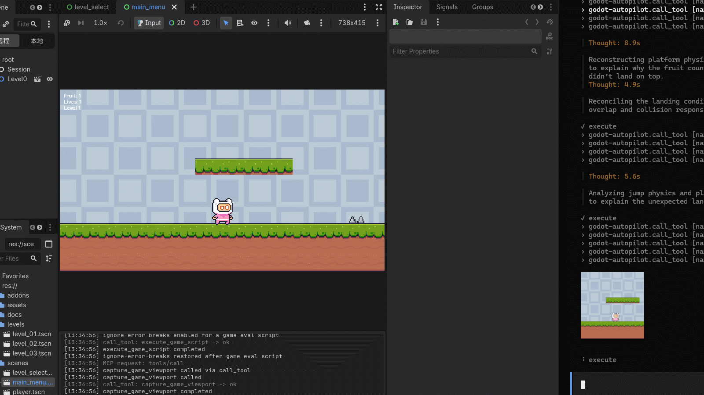

# Godot Autopilot

[](LICENSE)
[](https://github.com/jesspig/Godot-Autopilot/releases)
[](https://github.com/jesspig/Godot-Autopilot/actions)
[](https://github.com/jesspig/Godot-Autopilot/actions/workflows/release.yml)


[](https://modelcontextprotocol.io/)


> **AI 에이전트가 에디터 안에서 Godot 게임을 빌드하고, 플레이테스트하고, 디버깅하게 하세요.**

[English](README.md) | [简体中文](README.zh-CN.md) | [繁體中文](README.zh-TW.md) | [日本語](README.ja.md) | **한국어**

> 이 번역은 영문 [README.md](README.md)를 기준으로 합니다.

Godot Autopilot(GDA)은 **Godot 에디터 내부**에 플러그인으로 상주하는 [MCP](https://modelcontextprotocol.io/) 서버입니다. 설치하면 AI 코딩 어시스턴트(Claude Code, Cursor, Codex, OpenCode 등)가 사용자와 똑같은 방식으로 프로젝트를 다룹니다. 씬을 만들고, 속성을 조정하고, 게임을 실행하고, 버튼을 누르고, 스크린샷을 찍고, 로그를 읽은 다음, 확인한 내용을 바탕으로 계속 반복 개선합니다. 브리지 프로세스도 없고, 오류를 채팅창에 복사해 붙여넣을 필요도 없습니다. 그래픽 에디터 세션에서는 프로젝트를 열면 서버가 시작되고, 프로젝트를 닫으면 서버가 중지됩니다.



**252개의 도구**가 에디터에서 게임까지 이어지는 전체 루프를 아우릅니다: 도메인 도구 246개, 메타 도구 5개, `system_status`(정확한 개수는 버전마다 늘어나므로 `search_tools`로 에이전트에게 확인하도록 요청하세요). 325개의 이전 도구 이름 별칭은 0.6.0까지 `call_tool`로 호출할 수 있습니다(실제 도구와 이름이 겹치면 실제 도구가 우선). 스킬북은 **진입 카드 1장과 references 9편**으로 호출 프로토콜을 가르칩니다. MCP가 중단되면 GDA CLI로 대체합니다. 참고: [도구 면](docs/wiki/tool_surface_baseline.md), [스킬](docs/wiki/modules/skills.md), [CLI](docs/wiki/modules/cli.md).

## 빠른 시작

**Godot 4.7+**와 그래픽 에디터 세션이 필요합니다.

1. **설치** — Godot 프로젝트 루트에서 원클릭 스크립트를 실행하거나, 수동 릴리스 설치 및 소스 빌드 경로는 [INSTALL.md](INSTALL.md)를 따르세요.
   - macOS/Linux:

     ```bash
     curl -fsSL https://raw.githubusercontent.com/jesspig/Godot-Autopilot/master/scripts/install.sh \
       | bash -s -- --project "$PWD" --skills
     ```

   - Windows PowerShell:

     ```powershell
     & ([scriptblock]::Create((irm https://raw.githubusercontent.com/jesspig/Godot-Autopilot/master/scripts/install.ps1))) `
       -Project (Get-Location).Path -Skills
     ```

   스크립트는 `gda` CLI를 설치하고, `project.godot`을 감지하고, 플러그인을 설치하며, 선택적으로 스킬북을 설치합니다.
2. **프로젝트 열기** — 그래픽 에디터 세션에서는 서버가 자동으로 시작되고, 최초 실행 시 빈 루프백 포트를 하나 바인딩합니다(프로젝트별로 유지되며 `20000–29999`에서 선택). 헤드리스/커맨드라인 에디터 세션에서는 서버가 시작되지 않습니다.
3. **AI 클라이언트 연결** — `gda status --json`을 실행하고 그 `mcp_url`을 클라이언트의 MCP 설정에 추가하세요(또는 URL을 에이전트에게 넘기고 설정을 생성해 달라고 요청하세요). Streamable HTTP를 지원하는 MCP 클라이언트라면 무엇이든 연결할 수 있으며, Claude Code, Codex, Cursor, OpenCode, Copilot 등이 대표적입니다.
4. **요청하기** — 예: “달리고 점프할 수 있는 플레이어 캐릭터를 만들고, 플레이테스트한 뒤 이상해 보이는 부분을 고쳐 줘.”

## 안전 참고 사항

서버는 머신의 루프백 주소에서만 수신 대기하며(포트는 플러그인이 프로젝트별로 선택하고 경로는 `/mcp`로 고정), 로컬이 아닌 주소는 거부합니다. 고위험 도구(`destructive`, `process`, `code_execute`, `game_runtime`)는 `confirm=true`가 필요하며, 전역 허용 목록은 없습니다. 자세한 내용: [docs/wiki/security_contract.md](docs/wiki/security_contract.md).

## 문서

- [INSTALL.md](INSTALL.md) — 원클릭 스크립트, 수동 릴리스 설치, 소스 빌드, 에이전트 지침.
- [docs/wiki/index.md](docs/wiki/index.md) — 프로젝트 지식 베이스: 아키텍처, 모듈, 테스트, 규칙.
- [docs/wiki/tool_surface_baseline.md](docs/wiki/tool_surface_baseline.md) — 도구 면, 별칭, schema, 역량 행렬 기준선.
- [docs/wiki/build.md](docs/wiki/build.md) — 빌드, 배포, 패키징.
- [docs/wiki/modules/cli.md](docs/wiki/modules/cli.md) — 전체 CLI 레퍼런스.
- [docs/wiki/modules/skills.md](docs/wiki/modules/skills.md) — 스킬북과 `gda install skills`.
- [tests/README.md](tests/README.md) — 테스트 구성과 명령.

## 라이선스

MIT
