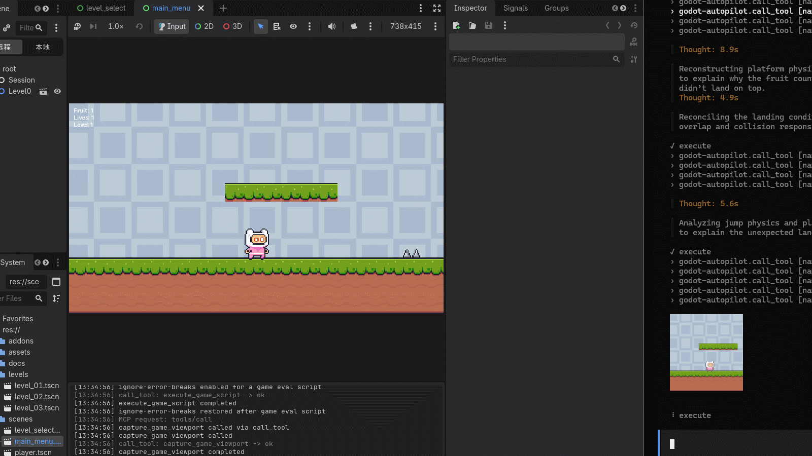

# Godot Autopilot

[](LICENSE)
[](https://github.com/jesspig/Godot-Autopilot/releases)
[](https://github.com/jesspig/Godot-Autopilot/actions)
[](https://github.com/jesspig/Godot-Autopilot/actions/workflows/release.yml)


[](https://modelcontextprotocol.io/)


> **Let an AI agent build, playtest, and debug your Godot game — from inside the editor.**

**English** | [简体中文](README.zh-CN.md) | [繁體中文](README.zh-TW.md) | [日本語](README.ja.md) | [한국어](README.ko.md)

Godot Autopilot (GDA) is an [MCP](https://modelcontextprotocol.io/) server that lives **inside the Godot editor** as a plugin. Your AI coding assistant (Claude Code, Cursor, Codex, OpenCode, …) then operates the project the way you do: builds scenes, tweaks properties, runs the game, presses buttons, takes screenshots, and reads logs — then iterates on what it sees. No bridge process and no copy-pasting errors into chat. A graphical editor session starts the server when the project opens and stops it when the project closes.



**253 tools** cover the editor-to-game loop: 247 domain tools, 5 meta tools, and `system_status` (the exact count grows with each version; ask the agent to check via `search_tools`). 325 deprecated tool-name aliases stay callable through `call_tool` until 0.6.0 (names still exposed as real tools win). Skill books (**1 entry card + 9 references**) teach the calling protocol; the CLI is the fallback when MCP is down. References: [tool surface](docs/wiki/tool_surface_baseline.md), [skills](docs/wiki/modules/skills.md), [CLI](docs/wiki/modules/cli.md).

## Quick start

Requires **Godot 4.7+** and a graphical editor session.

1. **Install** — run the one-click script from your Godot project root, or follow [INSTALL.md](INSTALL.md) for the manual release and source-build paths.
   - macOS/Linux:

     ```bash
     curl -fsSL https://raw.githubusercontent.com/jesspig/Godot-Autopilot/master/scripts/install.sh \
       | bash -s -- --project "$PWD" --skills
     ```

   - Windows PowerShell:

     ```powershell
     & ([scriptblock]::Create((irm https://raw.githubusercontent.com/jesspig/Godot-Autopilot/master/scripts/install.ps1))) `
       -Project (Get-Location).Path -Skills
     ```

   The script installs the `gda` CLI, detects `project.godot`, installs the plugin, and optionally installs skill books.
2. **Open your project** — in a graphical editor session the server starts automatically and binds a free loopback port on first launch (persisted per project, chosen from `20000–29999`). Headless/cmdline editor sessions do not start the server.
3. **Connect your AI client** — run `gda status --json` and add its `mcp_url` to your client's MCP configuration (or hand the URL to your agent and ask it to generate the config). Any MCP client that supports Streamable HTTP can connect; examples include Claude Code, Codex, Cursor, OpenCode, and Copilot.
4. **Ask for something** — e.g. “create a player character that can run and jump, then playtest it and fix what looks wrong.”

## Safety notes

The server only listens on your machine's loopback address (a per-project port chosen by the plugin, fixed path `/mcp`) and refuses non-local addresses. High-risk tools (`destructive`, `process`, `code_execute`, `game_runtime`) require `confirm=true` — there is no global allow list. Details: [docs/wiki/security_contract.md](docs/wiki/security_contract.md).

## Documentation

- [INSTALL.md](INSTALL.md) — one-click script, manual release install, source build, and agent instructions.
- [docs/wiki/index.md](docs/wiki/index.md) — project knowledge base: architecture, modules, tests, and conventions.
- [docs/wiki/tool_surface_baseline.md](docs/wiki/tool_surface_baseline.md) — tool surface, aliases, schema and capability baselines.
- [docs/wiki/build.md](docs/wiki/build.md) — build, deploy, and package.
- [docs/wiki/modules/cli.md](docs/wiki/modules/cli.md) — full CLI reference.
- [docs/wiki/modules/skills.md](docs/wiki/modules/skills.md) — skill books and `gda install skills`.
- [tests/README.md](tests/README.md) — test layout and commands.

## License

MIT
