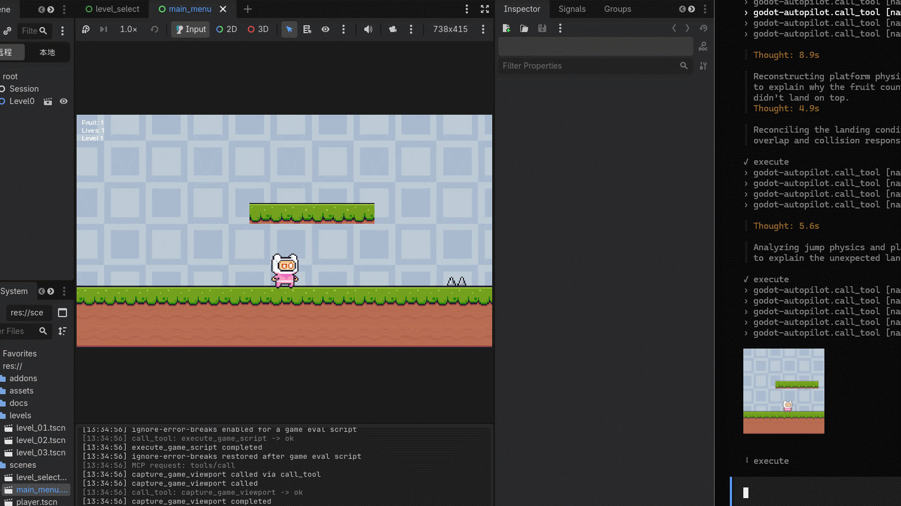

# Godot Autopilot

[](LICENSE)
[](https://github.com/jesspig/Godot-Autopilot/actions)


[](https://modelcontextprotocol.io/)


> **Let an AI agent build, playtest, and debug your Godot game — from inside the editor.**

**English** | [简体中文](README.zh-CN.md) | [繁體中文](README.zh-TW.md) | [日本語](README.ja.md) | [한국어](README.ko.md)

Godot Autopilot (GDA) is an [MCP](https://modelcontextprotocol.io/) server that lives **inside the Godot editor** as a plugin. Once installed, your AI coding assistant (Claude Code, Cursor, Codex, OpenCode, …) can operate your project the way you do: build scenes, tweak properties, run the game, press buttons, take screenshots, and read the logs — then iterate on what it sees.

No bridge process, no copy-pasting errors into a chat window. In a graphical editor session the server starts when your project opens and stops when it closes.

## End-to-end demo

AI controlling a game character in real time during end-to-end tests:



## What it can do

Over **452 tools** covering the whole editor-to-game loop (the exact count grows with each version — ask the agent to check via `search_tools`). Highlights:

- **Build scenes** — create, rename, move, and delete nodes; read and write properties; connect signals; build 3D block levels with GridMap (e.g. `create_scene_node`, `property_set`, `signal_connect`, `scene_tree_items`; GridMap: `create_gridmap`, `set_gridmap_cell`, `fill_gridmap_box`).
- **Look, sound, and feel** — meshes and materials, lights and environments, audio playback, animations and tweens, UI themes, tilemaps (e.g. `create_animation`, `tween_editor_property`, `create_game_tween`, `play_audio_player`, `fill_tilemap_rect`).
- **Physics and navigation** — ray/shape casts, rigid bodies, navigation maps and path queries (e.g. `intersect_physics_3d_ray`, `create_nav_3d_map`, `get_nav_3d_map_path`).
- **Hands: input and UI automation** — simulate keys, mouse, and gamepad; click editor controls by name; run editor shortcuts; click buttons in the running game (e.g. `click_input_mouse`, `get_editor_ui_elements`, `click_editor_element`, `run_editor_shortcut`, `click_game_ui_element`).
- **Scripts and debugging** — run GDScript in the editor or in the game, launch long game scripts as background jobs, read plugin/game/script-error logs (e.g. `execute_script`, `execute_game_script`, `start_game_job`, `get_plugin_log`).
- **Project and knowledge** — read, search, and copy project files and directories, inspect project settings, query the engine's built-in API docs offline (e.g. `read_file`, `find_in_files`, `list_directory`, `copy_file`, `get_project_settings`, `get_docs_class`).
- **Play and verify visually** — launch the current scene, inject timed input sequences, screenshot the editor and the game, and diff before/after (e.g. `play_editor_current_scene`, `queue_game_input`, `capture_editor_viewport`, `capture_game_viewport`, `review_scene_visually`).

## Quick start

Requires **Godot 4.7+** and a graphical editor session.

1. **Install** — run the one-click script from your Godot project root, or follow [INSTALL.md](INSTALL.md) for the manual release and source-build paths.
   - macOS/Linux:
     ```bash
     curl -fsSL https://raw.githubusercontent.com/jesspig/Godot-Autopilot/master/scripts/install.sh \
       | bash -s -- --project "$PWD" --skills
     ```
   - Windows PowerShell:
     ```powershell
     & ([scriptblock]::Create((irm https://raw.githubusercontent.com/jesspig/Godot-Autopilot/master/scripts/install.ps1))) `
       -Project (Get-Location).Path -Skills
     ```
   The script installs the `gda` CLI, detects `project.godot`, installs the plugin, and optionally installs skill books.
2. **Open your project** — in a graphical editor session the server starts automatically and binds a free loopback port on first launch (persisted per project, chosen from `20000–29999`). Headless/cmdline editor sessions do not start the server.
3. **Connect your AI client** — run `gda status --json` and add its `mcp_url` to your client's MCP configuration (or hand the URL to your agent and ask it to generate the config). Any MCP client that supports Streamable HTTP can connect; examples include Claude Code, Codex, Cursor, OpenCode, and Copilot.
4. **Ask for something** — e.g. “create a player character that can run and jump, then playtest it and fix what looks wrong.”

High-risk tools (`destructive`, `process`, `code_execute`, `game_runtime`) require `confirm=true`; there is no global allow list.

## Install with an AI agent

Send this to an agent that has shell access on the same machine:

```text
Read https://github.com/jesspig/Godot-Autopilot/blob/master/INSTALL.md and install it.
```

The agent will locate the Godot project, install the CLI and plugin, ask whether skill books should be global or project-only, verify the connection with `gda status --json`, and report the MCP URL. Full agent rules are in [INSTALL.md](INSTALL.md).

## Skill books

The plugin ships **10 self-contained skill books** (an overview, plus scenes, resources, scripting, runtime, servers, content, C#, setup, and tools volumes). Install one scope:

```bash
# Global: shared by all Godot projects
gda install skills

# Project-only: kept with this project
gda install skills --path "<project>/.agents/skills"

# Chinese editions
gda install skills --zh
gda install skills --path "<project>/.agents/skills" --zh
```

The default target is `~/.agents/skills`. Clients that do not read that directory can use `--path <client-skills-dir>`. The skill books teach the calling protocol instead of leaving the agent to improvise. Positioning: MCP is the primary product channel; skills are the experience layer, and the calling guide falls back to the GDA CLI when MCP is down.

One editor panel comes with the plugin:

- **Log** — plugin-only log with level/category filters and search, so misbehaving calls are easy to trace.

## How the agent works with it

You don't need to memorize tool names. The agent follows a simple loop:

1. **Discover** — `search_tools` to find candidates, `get_tool_detail` to confirm parameters (never guess names).
2. **Act** — `call_tool` for one step, `batch_execute` for a batch.
3. **Verify** — screenshot the result, compare with the previous capture, fix, and repeat.

## Command-line access

Prefer a terminal to a chat client? The GDA CLI drives a running GDA instance from the shell — no MCP client integration needed. It is Bun + TypeScript, runs from source, and has **zero runtime dependencies** and no build step.

Run it one-off with `bunx` (quoted on PowerShell, because `#` starts a comment):

```bash
bunx "github:jesspig/Godot-Autopilot#0.3.3" ping
```

Or install it globally once and use the `gda` command:

```bash
bun install -g github:jesspig/Godot-Autopilot#0.3.3
gda ping
```

Command families: **calling** — `ping` / `status` / `categories` / `search` / `describe` / `call`; **lifecycle** — `list` / `start` / `stop` / `restart` / `logs`; **offline and assets** — `skills` / `tools` / `projects` / `cache` / `install` / `update` / `trace`.

Requires **Bun**; on a machine without Bun or Node, use the standalone `gda` binary from the Releases page instead (see [docs/wiki/modules/cli.md](docs/wiki/modules/cli.md) for the full reference).

## Safety notes

The server only listens on your machine's loopback address (a per-project port chosen by the plugin, fixed path `/mcp`) and refuses non-local addresses. High-risk tools (`destructive`, `process`, `code_execute`, `game_runtime`) require `confirm=true` — there is no global allow list. Details: [docs/wiki/security_contract.md](docs/wiki/security_contract.md).

## Documentation

- [INSTALL.md](INSTALL.md) — one-click script, manual release install, source build, and agent instructions.
- [docs/wiki/index.md](docs/wiki/index.md) — project knowledge base: architecture, modules, tests, and conventions.
- [docs/wiki/build.md](docs/wiki/build.md) — build, deploy, and package.
- [docs/wiki/modules/cli.md](docs/wiki/modules/cli.md) — full CLI reference.
- [tests/README.md](tests/README.md) — test layout and commands.

## Asset attribution

The 5 sample projects under `examples/` (2D/3D beginner tutorials, UI control gallery, viewport composition, networked Pong) come from the official [Godot demo projects](https://github.com/godotengine/godot-demo-projects); only their assets and clean project configurations are kept for testing. The sixth project, `examples/pink_man_adventure`, is an in-repo example restored from the historical `Example/` demo project: its 173 PNG assets come from Pixel Frog's Pixel Adventure 1 (CC0 1.0), and its design documentation is original to this repository. Copyright and licensing details live in each project's README and LICENSE files.

## License

MIT
