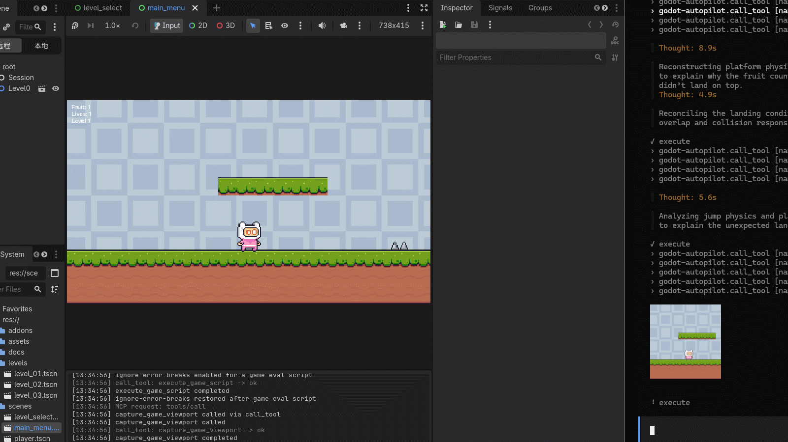

# Godot Autopilot

[](LICENSE)
[](https://github.com/jesspig/Godot-Autopilot/releases)
[](https://github.com/jesspig/Godot-Autopilot/actions)
[](https://github.com/jesspig/Godot-Autopilot/actions/workflows/release.yml)


[](https://modelcontextprotocol.io/)


> **让 AI 代理在编辑器里帮你搭场景、试玩和排错。**

[English](README.md) | **简体中文** | [繁體中文](README.zh-TW.md) | [日本語](README.ja.md) | [한국어](README.ko.md)

Godot Autopilot（GDA）是一个住在 **Godot 编辑器内部**的插件型 [MCP](https://modelcontextprotocol.io/) 服务端。装好之后，你的 AI 编程助手（Claude Code、Cursor、Codex、OpenCode 等）就能像你一样操作项目：搭场景、调属性、运行游戏、点按钮、截图、看日志——然后根据看到的结果继续迭代。不需要桥接进程，也不用把报错复制粘贴到聊天框。图形界面编辑器打开项目时服务端自动启动，关闭项目时自动停止。



**252 个工具**，覆盖从编辑器到游戏的完整闭环——246 个域工具 + 5 个元工具 + `system_status`（数量随版本增长，以代理通过 `search_tools` 查到的为准）；325 条旧工具名别名在 0.6.0 前经 `call_tool` 可调用（与实名工具重名的条目按实名工具优先）。完整工具面见 [docs/wiki/tool_surface_baseline.md](docs/wiki/tool_surface_baseline.md)。

技能书为 **1 张入口卡 + 9 篇 references**，教代理按调用协议执行；定位：MCP 是主产品通道，技能是体验层，调用指南在 MCP 失效时改用 GDA CLI。完整参考见 [docs/wiki/modules/skills.md](docs/wiki/modules/skills.md) 与 [docs/wiki/modules/cli.md](docs/wiki/modules/cli.md)。

## 快速开始

需要 **Godot 4.7+**，并使用图形界面编辑器。

1. **安装**——在 Godot 工程根目录运行一键脚本；手动安装与源码构建见 [INSTALL.md](INSTALL.md)。
   - macOS/Linux：

     ```bash
     curl -fsSL https://raw.githubusercontent.com/jesspig/Godot-Autopilot/master/scripts/install.sh \
       | bash -s -- --project "$PWD" --skills
     ```

   - Windows PowerShell：

     ```powershell
     & ([scriptblock]::Create((irm https://raw.githubusercontent.com/jesspig/Godot-Autopilot/master/scripts/install.ps1))) `
       -Project (Get-Location).Path -Skills
     ```

   脚本会安装 `gda` CLI、识别 `project.godot`、安装插件，并按需安装技能书。
2. **打开项目**——图形界面编辑器会自动启动服务端，首次启动时绑定一个空闲的环回端口（按工程持久化，取自 `20000–29999`）。无头/命令行编辑器模式不会启动服务端。
3. **连接 AI 客户端**——运行 `gda status --json`，把其中的 `mcp_url` 加进客户端的 MCP 配置（也可以把 URL 交给代理，让它生成配置）。任何支持 Streamable HTTP 的 MCP 客户端都可以连接；示例包括 Claude Code、Codex、Cursor、OpenCode、Copilot。
4. **提需求**——比如“创建一个能跑能跳的玩家角色，试玩一下并修掉看着不对的地方”。

## 安全说明

服务端只监听本机回环地址（端口由插件按工程选择，路径固定 `/mcp`），非本机地址一律拒绝。高风险工具（`destructive`、`process`、`code_execute`、`game_runtime`）需要 `confirm=true`，没有全局白名单。详见 [docs/wiki/security_contract.md](docs/wiki/security_contract.md)。

## 文档

- [INSTALL.md](INSTALL.md)——一键脚本、Release 手动安装、源码构建与代理安装说明。
- [docs/wiki/index.md](docs/wiki/index.md)——项目知识库：架构、模块、测试与约定。
- [docs/wiki/tool_surface_baseline.md](docs/wiki/tool_surface_baseline.md)——工具面、别名、schema 与能力矩阵基线。
- [docs/wiki/build.md](docs/wiki/build.md)——构建、部署与打包。
- [docs/wiki/modules/cli.md](docs/wiki/modules/cli.md)——完整 CLI 参考。
- [docs/wiki/modules/skills.md](docs/wiki/modules/skills.md)——技能书与 `gda install skills`。
- [tests/README.md](tests/README.md)——测试布局与命令。

## 许可证

MIT
