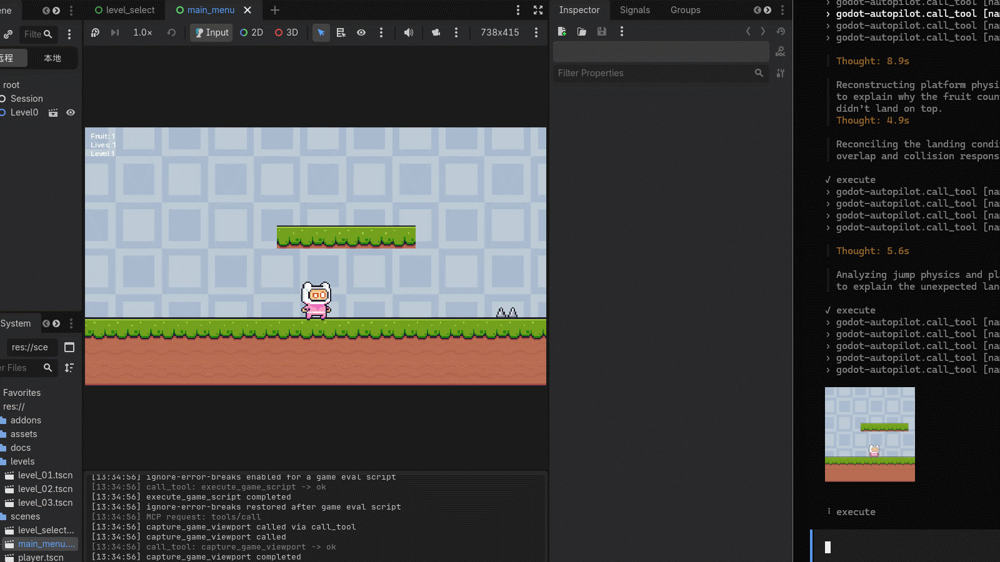

# Godot-Autopilot

[](LICENSE)
[](https://github.com/jesspig/Godot-Autopilot/actions)


[](https://modelcontextprotocol.io/)


> **讓 AI 代理在編輯器內幫你搭建場景、試玩與除錯。**

[English](README.md) | [简体中文](README.zh-CN.md) | **繁體中文** | [日本語](README.ja.md) | [한국어](README.ko.md)

Godot-Autopilot 是一個住在 **Godot 編輯器內部**的外掛型 [MCP](https://modelcontextprotocol.io/) 服務端。裝好之後，你的 AI 程式設計助理（Claude Code、Cursor、Codex、OpenCode 等）就能像你一樣操作專案：搭建場景、調整屬性、執行遊戲、點擊按鈕、截圖、查看日誌——然後根據看到的結果繼續迭代。

不需要橋接程序，也不用把報錯複製貼到聊天視窗。開啟專案時服務端自動啟動，關閉專案時自動停止。

## 端到端示範

端到端測試中，AI 即時控制遊戲角色：



## 能做什麼

超過 **452 個工具**，涵蓋從編輯器到遊戲的完整閉環（數量隨版本增長，以代理透過 `search_tools` 查到的為準）。重點功能：

- **搭建場景**——建立、重新命名、移動、刪除節點；讀寫屬性；連接訊號；以 GridMap 搭建三維方塊地圖關卡（如 `create_scene_node`、`property_set`、`signal_connect`、`scene_tree_items`；GridMap：`create_gridmap`、`set_gridmap_cell`、`fill_gridmap_box`）。
- **畫面、聲音與手感**——網格與材質、燈光與環境、音訊播放、動畫與補間、UI 主題、圖塊地圖（如 `create_animation`、`tween_editor_property`、`create_game_tween`、`play_audio_player`、`fill_tilemap_rect`）。
- **物理與導航**——射線/形狀檢測、剛體、導航地圖與尋路（如 `intersect_physics_3d_ray`、`create_nav_3d_map`、`get_nav_3d_map_path`）。
- **動手實作：輸入與 UI 自動化**——模擬鍵盤、滑鼠與手把；依名稱點擊編輯器控制項；執行編輯器快捷鍵；點擊執行中遊戲內的按鈕（如 `click_input_mouse`、`get_editor_ui_elements`、`click_editor_element`、`run_editor_shortcut`、`click_game_ui_element`）。
- **腳本與除錯**——在編輯器或遊戲中執行 GDScript，將耗時遊戲腳本作為背景工作執行，讀取外掛/遊戲/腳本錯誤日誌（如 `execute_script`、`execute_game_script`、`start_game_job`、`get_plugin_log`）。
- **專案與知識**——讀取、搜尋、複製專案檔案與目錄，檢視專案設定，離線查詢引擎內建 API 文件（如 `read_file`、`find_in_files`、`list_directory`、`copy_file`、`get_project_settings`、`get_docs_class`）。
- **試玩與視覺驗證**——執行目前場景，注入定時輸入序列，為編輯器與遊戲截圖，並比對前後差異（如 `play_editor_current_scene`、`queue_game_input`、`capture_editor_viewport`、`capture_game_viewport`、`review_scene_visually`）。

## 代理的使用方式

你不需要記住工具名稱。代理遵循這個簡單的循環：

1. **探索**——用 `search_tools` 尋找候選工具，用 `get_tool_detail` 確認參數（切勿猜測名稱）。
2. **執行**——單步操作用 `call_tool`，批次操作用 `batch_execute`。
3. **驗證**——截圖查看結果，與上一次截圖比對，有問題就修，修完再確認。

為了讓代理開箱即用，外掛自帶 **10 冊自包含技能書**（總覽，以及場景、資源、腳本、執行階段、伺服器、內容、C#、安裝、工具分冊）。以 `gda install skills` 安裝（加上 `--zh` 使用中文）；代理接著依呼叫協定操作，而非自行摸索。定位：MCP 是主要產品通道，技能書是體驗層——呼叫指南在 MCP 失效時改用 GDA CLI。

外掛隨附一個編輯器面板：

- **Log**——僅顯示外掛日誌，支援層級/分類篩選與搜尋，方便追蹤異常呼叫。

## 快速開始

需要 **Godot 4.7+**。

1. **取得外掛**——從專案的 GitHub Releases 頁面（[jesspig/Godot-Autopilot](https://github.com/jesspig/Godot-Autopilot)）下載 `addons.zip`，將其中的 `godot-autopilot/` 資料夾複製到你專案的 `addons/` 目錄：
   ```
   your-project/
   └── addons/
       └── godot-autopilot/
           ├── godot-autopilot.dll      (Windows)
           ├── libgodot-autopilot.so    (Linux)
           ├── libgodot-autopilot.dylib (macOS)
           └── godot-autopilot.gdextension
   ```
2. **開啟專案**——服務端自動啟動，首次啟動時綁定一個空閒的迴環連接埠（依專案持久化，取自 `20000–29999`）。無需啟用開關。
3. **連接 AI 客戶端**——執行 `gda status --json`，將其 `mcp_url` 加入客戶端的 MCP 設定（也可把 URL 交給代理，請它產生設定）。共支援 20 個客戶端，包括 Claude Code、Codex、Cursor、OpenCode 與 Copilot 等。
4. **確認高風險呼叫（選用）**——具 `destructive`、`process`、`code_execute`、`game_runtime` 副作用的工具需要 `confirm=true`；沒有全域允許清單。
5. **提出需求**——例如「建立一個能跑能跳的玩家角色，試玩一下並修正看起來不對的地方」。

想從原始碼建置或參與貢獻？見 [docs/wiki/](docs/wiki/)（入口 [index.md](docs/wiki/index.md)，建置見 [build.md](docs/wiki/build.md)）與 [tests/README.md](tests/README.md)。

## 命令列存取

想直接下指令而不接 MCP 客戶端？GDA CLI 讓你在終端機中驅動執行中的 GDA 實例，無需整合 MCP 客戶端。它基於 Bun + TypeScript，原始碼直跑，**零執行階段依賴**、無建置步驟。

用 `bunx` 單次執行（PowerShell 下需加引號，因為 `#` 會被視為註解）：

```
bunx "github:jesspig/Godot-Autopilot#0.3.3" ping
```

或全域安裝一次，之後直接使用 `gda` 命令：

```
bun install -g github:jesspig/Godot-Autopilot#0.3.3
gda ping
```

命令族：**呼叫族** —— `ping` / `status` / `categories` / `search` / `describe` / `call`；**生命週期** —— `list` / `start` / `stop` / `restart` / `logs`；**離線與資產族** —— `skills` / `tools` / `projects` / `cache` / `install` / `update` / `trace`。

需要 **Bun**；機器上沒有 Bun 或 Node 時，直接改用 Releases 頁的 `gda` 獨立執行檔（完整參考見 [docs/wiki/modules/cli.md](docs/wiki/modules/cli.md)）。

## 讓 AI 自己裝好並驗證

不想照上面的步驟手動來？把下面這段直接交給能在這台機器上執行指令的編碼代理，填上你專案的絕對路徑即可：

```text
Set up Godot Autopilot (GDA) on this machine end to end, then prove it works.

Project: <ABSOLUTE PATH TO YOUR GODOT PROJECT> (Godot 4.7+).

1. Install the plugin: download addons.zip from
   https://github.com/jesspig/Godot-Autopilot/releases/latest and extract it so that
   <project>/addons/godot-autopilot/godot-autopilot.gdextension exists.
2. Start the editor: run `godot --editor --path <project>` (ask me for the engine path if it is
   not on PATH) and wait until the `mcp_url` from `gda status --json` answers.
3. Verify the server from a shell. Try in this order, stop at the first that works, and tell me
   which one it was:
   - bunx "github:jesspig/Godot-Autopilot#0.3.3" ping
   - download the gda release asset for this OS and CPU from the same Releases page, verify it
     against sha256sums.txt, then run ./gda ping
4. Connect my AI client: add
   {"mcpServers":{"godot-autopilot":{"url":"<mcp_url from gda status --json>"}}}
   to its MCP configuration (or hand the URL to your agent and ask it to generate the config).
5. Summarize: which channel worked, every command you ran, and anything that failed.

Rules: never hand-write HTTP requests against the port; never expose the GDA port beyond loopback;
leave high-risk tools (code_execute, game_runtime, destructive, process) unconfirmed unless I ask for them.
```

如果你的客戶端支援技能（Claude Code、Codex、Cursor 等都支援），執行 `gda install skills`，代理就能拿到完整的呼叫協定，而不必自行摸索。

## 安全性說明

服務端僅監聽本機迴環位址（連接埠由外掛依專案選擇，路徑固定為 `/mcp`），非本機位址一律拒絕。高風險工具（`destructive`、`process`、`code_execute`、`game_runtime`）需要 `confirm=true`，沒有全域允許清單。詳見 [docs/wiki/security_contract.md](docs/wiki/security_contract.md)。

## 素材聲明

`demo/` 下的 5 個範例專案（2D/3D 入門教學、UI 控制項展示、視埠合成、連線 Pong）來自官方 [Godot 演示合集](https://github.com/godotengine/godot-demo-projects)，倉庫僅保留其素材與乾淨工程設定供測試使用。第 6 個專案 `demo/pink_man_adventure` 是從歷史 `Example/` 範例工程還原的倉庫內範例：173 張 PNG 素材來自 Pixel Frog 的 Pixel Adventure 1（CC0 1.0），設計文件為本倉庫原創。版權與授權見各專案目錄內的 README 與 LICENSE。

## 授權

MIT
