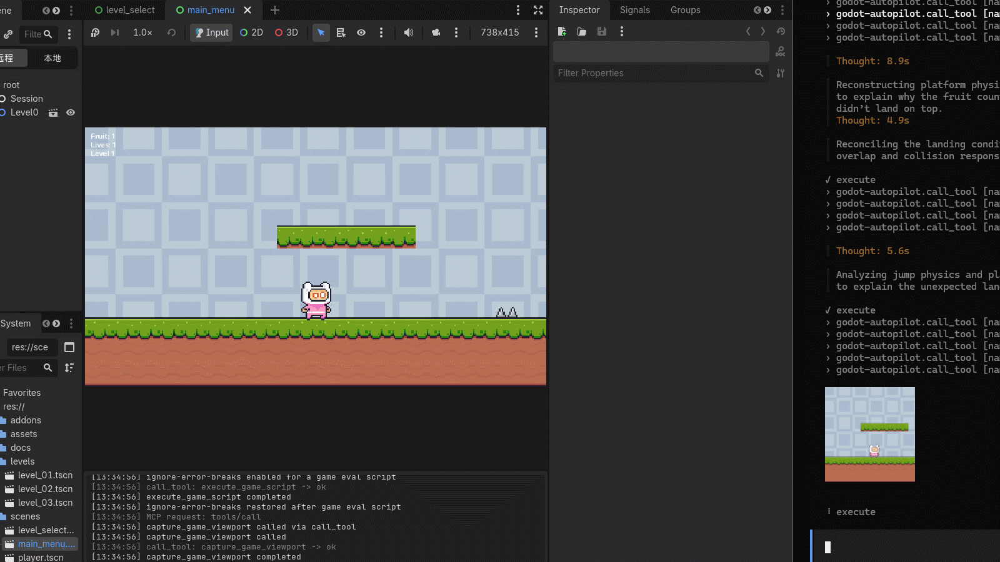

# Godot Autopilot

[](LICENSE)
[](https://github.com/jesspig/Godot-Autopilot/releases)
[](https://github.com/jesspig/Godot-Autopilot/actions)
[](https://github.com/jesspig/Godot-Autopilot/actions/workflows/release.yml)


[](docs/wiki/modules/cli.md)


> **讓 AI 代理在編輯器內部建置、試玩與除錯你的 Godot 遊戲。**

[English](README.md) | [简体中文](README.zh-CN.md) | **繁體中文** | [日本語](README.ja.md) | [한국어](README.ko.md)

> 本翻譯以英文版 [README.md](README.md) 為準。

Godot Autopilot（GDA）是以插件形式**常駐於 Godot 編輯器內部**，透過本機單一 `gda` CLI 暴露執行中的專案。沒有需要設定的協定或端點：AI 程式設計助理（Claude Code、Cursor、Codex、OpenCode 等）像你一樣透過 CLI 指令操作專案：建置場景、調整屬性、執行遊戲、按下按鈕、截圖、讀取日誌，再依據所見結果反覆迭代。不需要橋接程序，也不必把錯誤訊息複製到聊天視窗。圖形化編輯器工作階段中，外掛隨專案開啟自動登錄實例、隨專案關閉自動登出。



**252 個工具**涵蓋從編輯器到遊戲的完整閉環：246 個領域工具 + 5 個元工具 + `system_status`（實際數量隨版本成長，以 `gda tool list` 查詢為準）。325 條舊工具名別名在 0.6.0 前可用 `gda tool describe` 解析、用 `gda tool call` 呼叫（與實名工具重名者以實名工具優先）。外掛內建 **1 張入口技能卡與 9 篇 references**，教代理依 CLI 呼叫協定執行。參考：[工具面](docs/wiki/tool_surface_baseline.md)、[技能](docs/wiki/modules/skills.md)、[CLI](docs/wiki/modules/cli.md)。

## 快速開始

需要 **Godot 4.7+**，並使用圖形化編輯器工作階段。

1. **安裝**——在 Godot 專案根目錄執行一鍵腳本，或依 [INSTALL.md](INSTALL.md) 採手動 Release 安裝與原始碼建置途徑。
   - macOS/Linux：

     ```bash
     curl -fsSL https://raw.githubusercontent.com/jesspig/Godot-Autopilot/master/scripts/install.sh \
       | bash -s -- --project "$PWD" --skills
     ```

   - Windows PowerShell：

     ```powershell
     & ([scriptblock]::Create((irm https://raw.githubusercontent.com/jesspig/Godot-Autopilot/master/scripts/install.ps1))) `
       -Project (Get-Location).Path -Skills
     ```

   腳本會安裝 `gda` CLI、偵測 `project.godot`、安裝外掛，並可選擇安裝技能書。
2. **開啟你的專案**——在圖形化編輯器工作階段中，外掛會自動向 CLI 登錄實例，並於首次啟動時綁定一個空閒的迴環連接埠（依專案持久化，選自 `20000–29999`）。無頭/命令列編輯器工作階段不會提供實例。
3. **透過 CLI 連接**——執行 `gda ping` 與 `gda status --format json`，JSON 連線記錄確認實例在線及其本機端點。無需客戶端設定：一切操作都是輸出 JSON 信封的 `gda` 指令。Claude Code、Codex、Cursor、OpenCode 與 Copilot 都可直接驅動 CLI。
4. **提出需求**——例如「建立一個能跑能跳的玩家角色，接著試玩並修正看起來不對的地方」。

## 安全性說明

CLI 只連接本機迴環實例（連接埠由外掛依專案選擇，由 CLI 自動定址），並拒絕非本機位址。高風險工具（`destructive`、`process`、`code_execute`、`game_runtime`）需要 `--confirm`——沒有全域允許清單。詳見 [docs/wiki/security_contract.md](docs/wiki/security_contract.md)。

## 文件

- [INSTALL.md](INSTALL.md)——一鍵腳本、手動 Release 安裝、原始碼建置與代理安裝說明。
- [docs/wiki/index.md](docs/wiki/index.md)——專案知識庫：架構、模組、測試與慣例。
- [docs/wiki/tool_surface_baseline.md](docs/wiki/tool_surface_baseline.md)——工具面、別名、schema 與能力矩陣基線。
- [docs/wiki/build.md](docs/wiki/build.md)——建置、部署與封裝。
- [docs/wiki/modules/cli.md](docs/wiki/modules/cli.md)——完整 CLI 參考。
- [docs/wiki/modules/skills.md](docs/wiki/modules/skills.md)——技能書與 `gda install skills`。
- [tests/README.md](tests/README.md)——測試結構與命令。

## 授權

MIT
