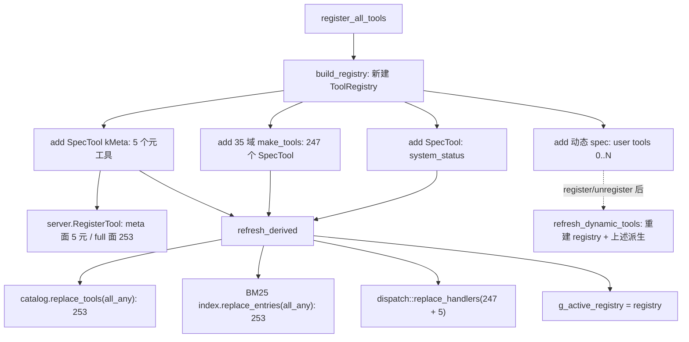

# 工具注册表（src/tools/ 注册管线）

> 审计日期：2026-11-24（工具面 253 = 247 域 + 5 元 + `system_status`；35 个域文件、28 个 category、325 个生产别名；schema 235 非空 / 17 空；Tasks 存储路径修正见正文）
> 覆盖范围：`register_all.cpp/hpp`、`dispatch.cpp/hpp`、`tool_catalog.cpp/hpp`、`schema_builder.cpp/hpp`、`tool_spec.hpp`、`tool_args.cpp/hpp`、`tool_pipeline.cpp/hpp`、`tool_base.hpp`、`tool_registry.hpp`、`dynamic_spec_store.hpp`、`autopilot_tools.cpp/hpp`、`side_effect_policy.hpp`、`confirmation.hpp`、35 个域 `*_tools.hpp`，对照 `tests/unit/register_all_test.cpp`、`tests/unit/tool_registry_test.cpp`、`tests/unit/confirmation_test.cpp`、`tests/unit/tool_verdict_test.cpp`、`tests/guard/` 与仓库根 `AGENTS.md`。
> 相关页面：[ToolSpec 数据层与执行管线](../tool_base_design.md) · [别名约定](../tool_surface_conventions.md) · [测试体系](../tests.md) · [端口与实例登记](ports.md) · [工具实现 A 组](tools_ops_a.md) · [工具实现 B 组](tools_ops_b.md) · [入口与运行时](entry_runtime.md) · [架构总览](../overview.md)

## 注册管线流程

工具注册发生在 `register_all_tools()`（`src/tools/base/register_all.cpp`），唯一来源是 `ToolRegistry`：**247 个域工具 + `system_status` + 5 个元工具 = catalog 253 条**，全部为 `ToolSpec` 数据记录（`make_spec_tool` → `SpecTool`，见 [ToolSpec 数据层与执行管线](../tool_base_design.md)）。域工具定义在 `src/tools/domains/<域>/<域>_tools.hpp`（35 个域文件，共 247 条 `ToolSpec`），每域 `make_tools()` 返回 `vector<unique_ptr<ToolBase>>`；每个工具 = `const std::vector<ParamSpec>` 参数表 + 一行 `make_spec_tool(ToolSpec{...})`。

`build_registry()` 的注册顺序固定：先 add `system_status`（`kHealthProbe`），再逐域注册 35 个 `make_tools()`，再 add 5 个元工具（`flags = kMeta` 自动归入 meta 表），最后追加 `dynamic_specs::store()` 中的用户脚本工具（`kDynamic`）。注册末尾调 `audit_destructive_declarations(*registry)`（`src/tools/base/register_all.cpp`）：用 `side_effect_policy::destructive_suspects()` 扫描 `all_any()`，对「名字/描述像破坏性但未声明 `Destructive`」的工具写一条 Tools Warning 并记 `destructive_declaration_audit` lifecycle 事件（带 `suspects` 计数），命中即说明声明与实际语义可能不符；现有 3 条豁免见 `side_effect_policy.hpp` 的 `kDestructiveExemptions`。`refresh_derived()` 从 registry 派生 catalog、BM25 索引与 dispatch handlers。

- **数据记录**：`ToolSpec{name, description, category, tags, side_effect, flags, params, handler, raw_schema, aliases, examples}`；`flags` 为 `tool_flags` 位标志（`kMeta` / `kDynamic` / `kMutating` / `kObserve` / `kCaptureImage` / `kSceneTarget` / `kUndoable` / `kHealthProbe` / `kLongBlocking`，共 9 位）。`ToolRegistry::add()` 按 `flags & kMeta` 自动路由，不依赖 `dynamic_cast` 分类。
- **`side_effect`（10 值）**：`none` / `writes_file` / `writes_config` / `writes_scene` / `shows_alert` / `modifies_window` / `process` / `code_execute` / `game_runtime` / `destructive`；只读工具回显 `"none"`。当前分布（253 条，按当前 `tools` 数组重算）：`none` 150、`writes_scene` 29、`modifies_window` 20、`writes_file` 14、`writes_config` 8、`destructive` 7、`process` 7、`game_runtime` 7、`code_execute` 6、`shows_alert` 4。2026-11-23 起 `run_gdscript_tests` 由 `none` 改为 `code_execute`（同时置 `kMutating`）；高风险四类（`destructive` / `process` / `code_execute` / `game_runtime`）合计 27 个，要求 `arguments.confirm=true`；`confirm` 只防误触，不是安全边界。
- **schema 单一源**：`SpecTool` 构造时 `schema_ = raw_schema.IsObject() ? raw_schema : schema::build_schema(params)`；域工具与 `system_status` 均从参数表派生，5 个元工具中 `search_tools` / `batch_execute` / `code_execute` 因嵌套结构手写 JSON 存入 `raw_schema`，`get_tool_detail` / `call_tool` 经 `build_schema`。
- **取参**：`Args`（`tool_args.hpp/cpp`）提供 `opt_*` / `require_*` / `get_*` 与 `reject_unknown()`，新增 `validate_declared()`（按参数表逐项校验必填与类型）；`null` 视为缺失，`integer` 接受整数值 double、拒绝小数与越界，`boolean` 严格。错误消息 `missing required parameter: X` / `invalid parameter: X must be a ...` 由 handler 抛出后经 dispatch 统一包装。域 handler 仍以 `args.Find(...)` 为主；但 `kDynamic` 工具已在 `SpecTool::execute()` 入口经 `spec_detail::validate_dynamic_args()` 用 `Args` 校验（必填/类型 + 拒绝未声明参数，`confirm` 例外），详见 [ToolSpec 数据层与执行管线](../tool_base_design.md)。新增域工具跟随所在域的既有写法。
- **生命周期**：`g_active_registry` 为 mutex 保护的 `shared_ptr<ToolRegistry>`；`register_all_tools` / `refresh_dynamic_tools` 每次先构建局部 registry，再经 `refresh_derived` 批量替换 catalog/index/dispatch。dispatch handler 捕获 registry 并在调用时 `find` 取工具，旧请求持有的 registry 由共享所有权延长生命周期。
- **动态工具**：`AutopilotTools`（`autopilot_tools.cpp`）把用户工具 spec 存入 `dynamic_spec_store.hpp` 的 store()（互斥保护），注册/注销后调 `refresh_dynamic_tools()` 全量重建；工具带 `kDynamic`，重名或与内置工具碰撞拒绝。目录批量注册入口 `rescan(directory)`（默认 `res://addons/godot-autopilot-tools`；前缀校验、256 文件、深度 8、逐文件错误隔离，返回 `scanned` / `registered` / `failed` / `errors`）。

## 三层结构

| 层 | 载体 | 数量 | 内容 |
|---|---|---|---|
| 单一来源层 | `ToolRegistry`（`g_active_registry`） | **253** | `all()`=247（247 域 + `system_status`）+ `all_meta()`=5 |
| MCP 服务器层 | `server.RegisterTool()`（派生自 registry） | **5**（默认 meta 面） | 元工具（`kMeta`） |
| 分发层 | `dispatch::g_handlers` + `g_meta_handlers`（派生） | **253** | 247 域/系统 + 5 元 |
| 目录层 | `ToolCatalog`（派生） | **253** | 247 域 + `system_status` + 5 元 |

默认 `meta` 面下领域工具不注册进 MCP 工具列表，只能经 `call_tool` 代理调用；经 `call_tool` 可达 247 个非元工具（含 `system_status`）。`ToolCatalog` 由 `refresh_derived` 对 `all_any()` 逐一 `make_tool_info` 派生，`dynamic` / `mutating` 字段来自 `tool_flags`。`GODOT_AUTOPILOT_TOOL_SURFACE=full` 时改为注册 `all_any()` 全部 253 个顶层工具。

## 生产别名（325）

- 别名由 `ToolSpec.aliases` 随工具进入 `ToolRegistry::aliases_`；不占 catalog、不进 `search_tools` 的 BM25 索引，也不改变 `tool_count`。
- `call_tool` / `batch_execute` 经 `dispatch::call_handler` 先 `resolve_alias(name)`，再按 canonical 名查找 handler；`apply_alias_args` 适配旧参数并保留 `confirm=true`，`apply_alias_result` 投影结果并在顶层追加 `deprecated_alias` / `canonical_name` / `alias_removal_version` / `deprecated_since`。
- `get_tool_detail(alias)` 返回 canonical 工具详情，并在顶层附同样的弃用字段；命中别名写一条 `Warning` 级 Tools 日志。
- 当前 325 个别名统一 `deprecated_since="0.4.0"`、`removal_version="0.6.0"`；完整契约见 [工具面别名约定](../tool_surface_conventions.md)。

## MCP 工具面（meta / full）

- `GODOT_AUTOPILOT_TOOL_SURFACE`：`meta`（默认）只注册 5 个元工具；`full` 注册 registry 的 `all_any()` 全部 253 个；非法值回退 `meta` 并写 Warning。解析在 `register_all.cpp` 的 `resolve_tool_surface()`。
- 两种面共用同一个 `register_surface_tool()` 回调：导出拦截、trace context、错误水位、`is_error`、`kCaptureImage` 图片附件、`call_tool` 编排线程规则全部一致；full 不绕过 `confirm`、主线程派发或环回绑定。
- `ServerOptions::enable_progressive_discovery=true`：`tools/list` 按 100 条/页分页，full 为 3 页（100/100/52），meta 为 1 页；客户端必须处理 `nextCursor`。`ListToolsAll()` 自动翻页。
- 风险：full 会让无宿主侧 tool search 的客户端一次性加载 253 个定义，只应对支持 tool search / defer loading 的本地宿主开启；云端 Anthropic API 需要可达 URL，GDA 仅绑环回，不直接适用。
- 动态用户工具注册/注销后，full 面发送 `notifications/tools/list_changed`；meta 面不发送（5 个元工具不随动态工具变化）。

## 元工具与系统状态

- 5 个元工具均为 `SpecTool` + `flags = kMeta`，经 `register_all.cpp` 的派生循环 `server.RegisterTool`；`g_meta_handlers`（`refresh_derived` 从 `all_meta()` 派生）供分发层复用——`call_handler` 未命中 `g_handlers` 时查 `g_meta_handlers`。

| 元工具 | 职责 |
|---|---|
| `search_tools` | BM25 检索真实工具；`limit` 默认 20、`0` 全量、负值报 `invalid parameter`；`categories=true` 返回分类计数。`list_categories` 是其别名 |
| `get_tool_detail` | 获取单个 canonical 工具的完整 schema；传别名返回 canonical 详情并附弃用字段 |
| `call_tool` | 按名称代理调用领域工具或 `system_status`；解析别名、等待异步结果、附加截图 image content，并检查 `error` 置 `is_error`；递归深度守卫（≥8 拒绝）与按目标工具副作用触发的 elicitation 见下方 |
| `batch_execute` | 顺序批量执行多工具；`stop_on_error`、`rollback_on_error`、`await_async`；逐条返回结果。成功/失败判定统一走 `batch_verdict.hpp` 的 `op_succeeded()` → `spec_detail::verdict_of()`（顶层 `error`、`structured_error`、`runtime_error` 三条失败轨一视同仁），不再只看顶层 `error`；`$steps[N]` 序号解析与回滚 `rollback_partial` 计算见 [ToolSpec 数据层与执行管线](../tool_base_design.md) |
| `code_execute` | 执行任意 GDScript；支持 `function_name`、`timeout_ms`、`auto_owner`、`confirm` |

- `system_status` 是 `SpecTool`、非元工具，经 `call_tool` 调用；返回 `version` / `port` / `uptime_seconds` / `running` / `tool_count`（253）/ `queue_depth` 与 `main_thread` 对象（`last_drain_age_ms` / `queue_depth` / `queue_cancelled` / `queue_rejected_full` / `oldest_pending_ms`）。`ping` 是其别名。
- 元工具处理器用 `RequestContext::GetRequest().id` 建立 `monitor::RequestScope` 并经 `tools::RequestSpanGuard` 压入请求 span，使「协议请求 → call_tool → 域工具」trace 端到端关联。
- `call_tool` 对带 `__gda_pending` 的异步结果做等待（`runtime_ops::wait_pending_response`）；截图结果定型改为按工具名判定，仅 `capture_game_viewport` / `capture_editor_viewport` 走 `finalize_capture_response`，不再以结果含 `path` 推断。直连工具回调也会在 `dispatch::has_deferred_marker()` 命中时统一 `resolve_deferred_wait()`（新增 `csharp_build` → `editor_ops::wait_csharp_build` 分支）。`call_tool` 与 `batch_execute(await_async=true)` 的编排回调在 MCP 线程执行，领域工具 handler 仍由 dispatch 路由回主线程。
- `call_tool` 入口有线程局部递归深度守卫（`kMaxCallToolDepth = 8`，`call_depth_guard.hpp` 的 `call_depth_exceeds(current, max)` 判定 `current >= max`），超限返回 `call_tool recursion depth exceeded`；防止 `call_tool` 代理链自递归打穿调用栈。
- 图片附件按 `kCaptureImage` flag 判定：registry 已知工具含该 flag 时经 `util::try_attach_image_data` 附加截图 image content，仅未知工具名才走旧白名单 `is_image_capture_tool` 兜底；单元测试 `tool_pipeline_traits_test.cpp` 覆盖附件判定纯逻辑。

## Tasks、Progress、MRTR 与 Skills

- **Tasks**：`ServerContext` 固定启用 `enable_tasks_extension`，任务存储为 `<gda_home>/.godot-autopilot/tasks/tasks-<stamp>.jsonl` 的 `FileTaskStore`（11-18 修正：此前漏 `.godot-autopilot` 段落到 profile 根 `tasks/`；路径变更仅影响新会话，旧文件保留），装配时发 `tasks_enabled` lifecycle 事件、`path` 属性与存储路径同值；`call_tool` 以 `Task/Optional` 注册，支持 `tasks/get|update|cancel`，不支持任务的客户端同步退化。
- **Progress**：`batch_execute` 在请求带 progress token 时发送开始/结束两条 `notifications/progress`（当前不逐 operation 上报）。
- **MRTR**：full 面直接工具在客户端声明 elicitation 且未带 `confirm` 时返回 `input_required`；`accept` 注入 `confirm=true`，`decline/cancel` 不执行。2026-11-23 起 `call_tool` 也纳入同一 elicitation 判定（`call_tool_elicitation.hpp`）：代理时按 `args.name` 查目标工具（含别名解析）取其 `side_effect` 作为有效副作用，`should_elicit = required_for(effect) && !confirm_provided && client_supports_elicitation`；目标为高风险且未带 confirm 时同样返回 `input_required`，不再由 `call_tool` 自身的 `None` 副作用绕过。注入 confirm 后仍走目标工具的 `confirmation_required`。
- **Skills**：`enable_skills_extension=true`，1 张入口卡 + 9 篇 references 以 `godot://skills/<name>/SKILL.md` 注册为 `mcp::Skill`（resources=dynamic）；旧 `godot://skills/...` 资源保留。Skills 是 2026 协议能力：客户端必须先发 `server/discover`（不要用 `initialize`）再把 `MCP-Protocol-Version: 2026-07-28` 与 `params._meta` 带到 `skills/list|get`；`initialize` 仍按 2025-11-25 协商，供旧客户端使用。
- `gda status --json` 的 `mcp` 块暴露协议版本、capabilities 与 serverInfo，脚本可先判断扩展再选命令。

## Schema 统计口径

- 非空判定：`input_schema.properties` 存在且为非空对象；空 schema 仍保留空 `properties` 对象。当前基线 **253 = 235 非空 + 17 空**（`tests/data/tool_catalog_baseline.json` 的 `catalog_total` / `schema_non_empty` / `schema_empty`，由 `tests/support/tool_catalog_baseline.cpp` 读取，`register_all_test.cpp` 的 `SchemaStatisticsBaseline` 断言）。
- 全部 schema 由 `SpecTool` 构造期生成：域工具与 `system_status` 经 `schema::build_schema(params)`；`search_tools` / `batch_execute` / `code_execute` 手写 JSON 存 `raw_schema`。schema_builder API 面为 `ParamDef`、`build_schema(initializer_list<ParamDef>)`、`build_schema(const std::vector<ParamDef>&)`、`add_required_flag`。
- `search_tools` 的 `limit`：默认 **20**（空 query 与 BM25 结果都受限），`limit:0` 返回全量，负值或非整数返回 `invalid parameter: limit must be a non-negative integer`；遍历/契约测试必须显式传 `limit:0`。
- `ParamSpec` 的 `type` 支持 `string` / `number` / `integer` / `boolean` / `object` / `array` / `json`。`json` 表示接受任意 JSON 值（标量、数组、对象、null）：`schema::build_schema` 对该参数不写 `type`（只保留 `description`），值是否合法由 handler 自行校验。
- 数值以运行时统计为准；本页不复制遍历/测试计数，统一见 [测试体系](../tests.md)「数值核算总表」。

## 分发与错误路径（dispatch.cpp）

- `call_handler`：编辑器队列缺失/关闭/已满时返回结构化 `queue_unavailable`（`retryable=true`，不进入等待）；在主线程直接 `call_handler_impl`；非主线程经 `run_on_main_thread_with_budget`（内部 `submit_tracked` + 按 flags 决策的等待预算）排队执行。handler map 在锁内替换、复制后锁外执行。
- 主线程等待预算按工具 flags 决策：`kLongBlocking`（`code_execute` / `batch_execute`）用 29000ms（env `GODOT_AUTOPILOT_LONG_BLOCKING_TIMEOUT_MS`，钳制 `[1000, 29000]`）、`kHealthProbe`（`system_status` / `ping`）用 5000ms（env `GODOT_AUTOPILOT_HEALTH_TIMEOUT_MS`）、其余默认 27000ms（env `GODOT_AUTOPILOT_DISPATCH_TIMEOUT_MS`）。
- 等待超时先 `CommandQueue::cancel(id)` 取消未执行任务，返回结构化 `main_thread_timeout`（`retryable=false`，含 `tool` / `waited_ms` / `queue_depth` / `oldest_pending_ms` / `last_drain_age_ms` / `cancelled` / `cancelled_before_execution`），并直写一条 `dispatch_timeout` trace 与 Transport Warning。`code_execute` 的 `timeout_ms` 上界取 `min(27000, 生效长阻塞预算)`。
- 查找顺序：`g_handlers`（247 项）→ 命中即执行；异常分两路——`std::exception` 透出 `ex.what()`，其余按 `unexpected C++ exception` 兜底；两条路径均记 `error_code="internal"` 的 TraceEvent 与 Tools 日志；未命中再查 `g_meta_handlers`（5 元）；否则返回 `domain tool 'X' not found — use search_tools to discover available tools`。
- 导出保护：全部 5 个元工具与 full 面直接工具回调前置 `ExportGuard::is_exporting()` 检查，命中返回 `export_blocked_result()`；导出期拒绝另覆盖 **MCP 资源**（`resource_handlers.cpp` / `debugger_resources.cpp`）与 **MCP 提示词**（`prompt_handlers.cpp`）两类入口，共三类。
- trace 上下文：提交前 `capture_trace_context()`、主线程 lambda 内用 `ScopedTraceContext` 恢复，并按 `steady_clock` 计算排队等待；`call_handler` 捕获/恢复 `request_id`，handlers 互斥锁用 `LockProbe`（阈值 5ms，超阈值才记录）。
- 无统一 `tool_execute` / 参数校验器 / REST 信封：MCP 面 `call_tool` 直接走 `dispatch::call_handler`，导出拦截在回调入口、参数校验由 handler 内的 `Args` 抛错兜底、高风险工具由 `confirm=true` 在执行前拦截。

## 命名与类别

- 247 个域工具名全部匹配 `^[a-z0-9_]+$`（小写 snake_case）；绝大多数首段为动词（create/get/set/add/remove/apply/intersect/play/stop/save/seek/move/warp/…），5 个名词置首的既有例外：`property_get` / `property_set` / `property_get_list`、`signal_connect` / `signal_disconnect`。
- 当前 28 个 category（域工具侧 27 个；`Meta` 2 = `search_tools` / `get_tool_detail`，`System` 5 = 3 个元工具 + `system_status` + `get_game_log_entries`）。逐类分布与域文件对应关系见 [架构总览](../overview.md)「MCP 工具面」。
- 新增副作用工具只需在 `ToolSpec` 填对应 `side_effect` + `kMutating`（可选 `kDynamic` 由动态注册自动置位）；高风险工具自动要求 `confirm`，无需另改授权表。

## 出站链接

- [ToolSpec 数据层与执行管线](../tool_base_design.md)
- [工具面别名约定](../tool_surface_conventions.md)
- [测试体系](../tests.md)
- [端口与实例登记](ports.md)
- [工具实现 A 组](tools_ops_a.md)
- [工具实现 B 组](tools_ops_b.md)
- [入口与运行时](entry_runtime.md)
- [架构总览](../overview.md)
- [安全边界与并发契约](../security_contract.md)
