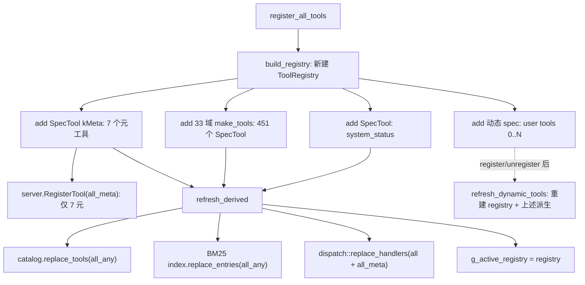

# 工具注册表（src/tools/ 注册管线）

> 审计日期：2026-10-21（**10-21 随面板授权开关补齐批次同步**——「授权三档」一节的**面板开关由三项扩为五项**（新增 `write` 与 `destructive`），补「面板可勾选的能力清单」表（复选框 ↔ 能力名 ↔ 覆盖工具类 ↔ 勾选后效果）、取消一项不影响其它项的增删语义、`process` 仍无面板开关的说明；**10-21 随数值同步批次更正**——本页不再复制遍历基线的排除数/候选数/步数/warnings 口径，一律改为引用 [测试体系](../tests.md)「数值核算总表」的遍历各行（最近一次 L2 实测：枚举 452 / 排除 147 / 候选 305 / `03_tools_contract` 实测 558 步 / `empty_args` warnings 基线 0）；「契约缺口表」中 `empty_args` 的 warnings 基线由 4 条改为 **0**（历史 4 条已修复，保留为历史说明）；10-21 随开放接口面落地批次同步——新增**统一执行入口** [`src/tools/tool_execute.hpp`](../../../src/tools/tool_execute.hpp) / [`src/tools/tool_execute.cpp`](../../../src/tools/tool_execute.cpp)（导出拦截 → 工具存在 → 参数校验 → 授权 → 派发 → 信封六阶段），六阶段已实现并由 L1 `tool_execute_test` 覆盖，但**尚未接入生产请求路径**（`api_surface` 的执行器槽位在生产路径上无注册点，MCP `call_tool` 走 `execute_tool_core` 直派）——两套面逐段生效差异见下「统一执行入口」；新增 [`src/tools/argument_validator.hpp`](../../../src/tools/argument_validator.hpp) / [`src/tools/argument_validator.cpp`](../../../src/tools/argument_validator.cpp) 参数校验器（**未知参数宽容**，只记 Warning 不拒绝）；**授权由「能力门」升级为三档**：读类默认放行、写类默认拒绝、危险类（`process` / `code_execute` / `game_runtime` / `destructive`）默认拒绝且需显式开启；`SideEffect` 增 `Destructive` 值（9 值）；`main_thread_timeout` 的 `retryable` 由 true 改为 **false**（调用已取消、副作用可能仍落地，不可盲目重试）；导出期拒绝**新增机器可读 `code="export_in_progress"`**；错误码归一（`ApiEnvelope::normalize_code` / `status_for`）与完整 HTTP 状态码表见 [REST 接口面](api.md)；端口模型见 [端口与实例登记](ports.md)；10-20 随 `code_execute` 超时上限收敛批次同步——长阻塞派发预算收敛为**单值 29000ms**（`GDA_DISPATCH_WAIT_LONG_BLOCKING_MS = GDA_DISPATCH_WAIT_MAX_MS`，删去「常量 30000 / 实际生效 29000」双值写法）；预算条目补 `queue_unavailable` 错误码（`error`/`code`/`retryable`）与 `code_execute` 的 `timeout_ms` 上界口径（取 `min(27000, 生效长阻塞预算)`）；10-20 随知识库事实描述页收敛批次同步——类别分布表经复核**逐项正确**（27 类求和 451），保持不变；`kLongBlocking` 语义由「返回 0 = 无限等待」更正为**长阻塞预算**（常量 `GDA_DISPATCH_WAIT_LONG_BLOCKING_MS` = 29000 ms，env `GODOT_AUTOPILOT_LONG_BLOCKING_TIMEOUT_MS` 可下调至 `[1000, 29000]`），`main_thread_wait_budget_ms` 由 3 参改 **4 参**（新增 `long_blocking_ms`）；`code_execute`/`batch_execute` 的 `side_effect` 现为 `SideEffect::CodeExecute`（回显 `code_execute`）；只读工具的 `side_effect` 回显由空串改为 **`"none"`**；能力门映射不再按工具名特判，只按 `SideEffect` 判定；遍历契约补「基线断言 + 工具错误判失败」两条：枚举/排除/候选/warnings 四项与 `tests/runner/traversal.cpp:22-25` 的基线常量逐项比对，不符即记 baseline diff；工具返回的错误若不含 `structured_error` 且消息不含豁免表任一标记即判 FAIL，豁免表为 `tests/runner/traversal.cpp:29-38` 的 `kExpectedErrorMarkers`）；2026-10-16（本轮随 text_ops C# 类解析修复与计数复核同步——域工具 448→451（+3：`csharp_tools` 5→6 `csharp_list_members`、`os_tools` 22→23 `create_csharp_script`、`editor_tools` 32→33 `dotnet_environment`），全系统 456→459（452 非元 + 7 元），schema 基线 456=390+66 → 459=393+66（L1 `register_all_test.cpp:142-144` 断言），`register_all.cpp` 的 `call_tool` 描述行同步为“452 非元（451 域 + system_status）”；L1 435（unit 41 文件）、L2 38、ctest 注册点 476；`parse_csharp_classes` 基类解析修复与验证证据见 [changelog/2026-10-16-log.md](../changelog/2026-10-16-log.md)）；2026-10-12（10-12 随 C# 桥补完批次同步——域工具 446→448（新增 csharp_set_property/csharp_unsubscribe_event，csharp_tools 3→5），全系统 454→456（449 非元 + 7 元），schema 基线 454=388+66 → 456=390+66（L1 register_all_test.cpp:142-144 已同步断言），register_all.cpp 的 call_tool 描述行已修正为“449 非元（448 域 + system_status）”；10-11 随 C# 反射桥批次同步——域工具 443→446（新增 csharp_get_property/csharp_call_method/csharp_subscribe_event，新域文件 csharp_tools.hpp，域模块 32→33；build_csharp_assembly 早先已随 editor 域计入），全系统 451→454（447 非元 + 7 元），schema 基线 451=385+66 → 454=388+66（L1 register_all_test.cpp:142-144 已同步断言），register_all.cpp 的 call_tool 描述行已修正为“447 非元（446 域 + system_status)”（此前遗留闭环）；10-11 随批量工具扩充批次同步——域工具 392→443（+51：animation +1、audio +4、config +4、os +4（`file_dir_ops` 新实现挂 `os_tools`）、game +4、input_map +1、physics +3、property +2、render +3、resource +7、scene +7、theme +2、新域 `gridmap` 5、`tween` 4；源模块 30→32，全系统 400→451，schema 基线 400=338+62 → 451=385+66；遍历枚举 393→444，排除与候选以运行时 `03_tools_contract` 报告为准，旧基线 71/322 已过时）；09-29 随 B1–B7 修复批次同步——工具 399→400（域工具 392，新增 `remove_resource_file`）；8 个 SceneTree 工具改经 `GDA_OP_SCENE_TREE` 转发到游戏进程并声明 `SideEffect::GameRuntime`，遍历排除 62→71、候选 330→322；schema 基线 400 = 338 非空 + 62 空；dispatch 新增 flags `kHealthProbe`/`kLongBlocking` 与主线程等待预算（默认 27000ms、健康探针 5000ms；超时取消 + `main_thread_timeout` 结构化错误）；2026-08-29 随 0.2.2 版本与全量审计同步；09-02 随 T0 安全边界与并发契约同步；09-13 上午随反馈修复批次同步工具数 365/372/373、Resources 26、SIDE 排除 49；09-13 下午随收口批次同步工具数 366/373/374 与 get_plugin_log；09-13 17:50 随 B 组知识库审计同步——修正契约缺口行号引用、schema 基线行号与元工具 schema 口径；09-13 晚随 0.2.4 版知识库全量审计同步——补正 populate_default_tools 存留状态与命名首段动词的 5 个既有例外；09-15 随 Computer Use grounding 批次同步工具数 379/386/387、非 SIDE 322 / SIDE 57、类别分布与遍历 warnings 实测 4 条；09-16 随失败修复批次同步工具数 384/391/392、非 SIDE 324 / SIDE 60；09-16 随视觉辅助批次同步工具数 385/392/393、Capture 1→2；09-18 随 E2E 优化批次同步工具数 391/398/399 与新增 6 工具；09-19 随 ToolSpec 数据化重构整体重写——全量工具改为 `ToolSpec` 数据记录（不再有宏/真类），删除 `tool_decl.hpp`/`fn_tool.hpp`/`meta_tools.hpp`/`IMetaTool` 与 8 个 `schema_*_ops.cpp`/`schema_fills.hpp`，新增 `tool_args`/`tool_pipeline`/`dynamic_spec_store`/`autopilot_tools` 与 `tests/guard/` 迁移守卫；catalog 399、MCP 恒 7、遍历改为运行时枚举 392 条后按 `side_effect`/`mutating`/`dynamic` 排除，实测 330 个进入两步骤；09-19 收尾第二轮随 traits/invoke/rescan/batch 同步图片附件 flag 判定与 rescan 入口；09-20 晚随可重放监控批次同步——dispatch 分发层补 trace 上下文跨线程传递/排队等待测量与未捕获异常埋点，用户工具碰撞拒绝改 `log_detailed`）；09-21 随可重放监控与日志系统批次同步——元工具处理器用 `RequestContext::GetRequest().id` 建立 `monitor::RequestScope` + `tools::RequestSpanGuard` 端到端关联，新增 `registry_build`/`registry_refresh_derived`/`registry_refresh_dynamic`/`tools_registered` lifecycle 事件，`system_status` 返回新增 `tool_count`/`queue_depth`）。
> 覆盖范围：`register_all.cpp/hpp`、`dispatch.cpp/hpp`、`tool_catalog.cpp/hpp`、`schema_builder.cpp/hpp`、`tool_spec.hpp`、`tool_args.cpp/hpp`、`tool_pipeline.cpp/hpp`、`tool_base.hpp`、`tool_registry.hpp`、`dynamic_spec_store.hpp`、`autopilot_tools.cpp/hpp`、`tool_execute.cpp/hpp`（10-21 新增：统一执行入口）、`argument_validator.cpp/hpp`（10-21 新增：参数校验器）、33 个域 `*_tools.hpp`，对照 `tests/runner/traversal.cpp`、`tests/unit/register_all_test.cpp`、`tests/unit/tool_registry_test.cpp`、`tests/unit/tool_execute_test.cpp`、`tests/unit/argument_validator_test.cpp`、`tests/unit/authorization_policy_test.cpp`、`tests/guard/`、`tests/config/03_tools_contract.json` 与仓库根 `AGENTS.md` 工具段。
> 相关页面：[ToolSpec 数据层与执行管线](../tool_base_design.md) · [测试体系](../tests.md) · [REST 接口面](api.md) · [端口与实例登记](ports.md) · [工具实现 A 组](../modules/tools_ops_a.md) · [工具实现 B 组](../modules/tools_ops_b.md) · [入口与运行时](../modules/entry_runtime.md) · [架构总览](../overview.md)

## 注册管线流程（ToolRegistry 单一来源 + 全量 ToolSpec，自 2026-09-19）

工具注册发生在 `register_all_tools()`（`src/tools/register_all.cpp`），现为 **ToolRegistry 单一来源**且 **451 域工具 + `system_status` + 7 元工具全部为 `ToolSpec` 数据记录**（`make_spec_tool` → `SpecTool`，细节见 [ToolSpec 数据层与执行管线](../tool_base_design.md)）。域工具定义在 `src/tools/<域>_tools.hpp`（33 个域文件），每域提供 `make_tools()` 返回 `vector<unique_ptr<ToolBase>>`；每个工具 = 参数表 `const std::vector<ParamSpec>` + 一行 `make_spec_tool(ToolSpec{...})`（元信息/副作用/flags/handler/schema 全部内联）。`build_registry()` 先 add `system_status`（SpecTool），再逐一注册 33 个域的 `make_tools()`，再 add 7 个元工具（`flags = kMeta` 自动归类），最后追加 `dynamic_specs::store()` 中的用户脚本工具（`kDynamic`）；`refresh_derived()` 从 registry 派生 catalog/BM25/dispatch handlers。

- **数据记录（非宏/非真类）**：`ToolSpec{name, description, category, tags, side_effect, flags, params, handler, raw_schema}`；`flags` 为 `tool_flags` 位标志（`kMeta`/`kDynamic`/`kMutating`/`kObserve`/`kCaptureImage`/`kSceneTarget`/`kUndoable`/`kHealthProbe`/`kLongBlocking`，共 9 位）。`ToolRegistry::add()` 按 `flags & kMeta` 自动路由（meta_ vs 域表），不再依赖 `dynamic_cast`。
- **side_effect 语义（2026-10-20 修正，2026-10-21 扩档）**：`SideEffect` 现为 **9 值**（新增 `Destructive`），经 `side_effect_name()` 回显为 `none`/`writes_file`/`writes_config`/`shows_alert`/`modifies_window`/`process`/`code_execute`/`game_runtime`/`destructive`——**只读工具回显 `"none"`**（原为空串）；`code_execute`/`batch_execute` 的 `side_effect` 声明为 `SideEffect::CodeExecute`（`register_all.cpp:504` / `:552`），回显 `code_execute`。能力门 `authorization::capability_for_tool(name, effect)` **不按工具名特判**，只按 `SideEffect` 映射到**三档七个能力名**（`read` / `write` / `process` / `code_execute` / `game_runtime` / `destructive` / `user_tools`）——**10-21 起写类不再「不需授权」**：`writes_file` / `writes_config` / `shows_alert` / `modifies_window` 归入 `write` 档、**默认拒绝**，需允许列表含 `write`（或 `all`）；读类（`none`）归 `read` 档、**默认放行**；`process` / `code_execute` / `game_runtime` / `destructive` 归危险档、**默认拒绝且需显式开启**。完整口径见下「统一执行入口」与 [T0 安全边界与并发契约](../security_contract.md) §3.1。
- **schema 单一源**：`SpecTool` 构造时 `schema_ = raw_schema.IsObject() ? raw_schema : schema::build_schema(params)`；域工具 schema 全部从参数表派生，7 元工具中 `search_tools`/`batch_execute`/`code_execute` 因嵌套结构手写 JSON 存入 `raw_schema`，其余经 `build_schema`（含 `system_status`）。
- **取参统一 `Args`**（`tool_args.hpp/cpp`）：`opt_*`/`require_*`/`get_*` + `reject_unknown()`；`null` 视为缺失，`integer` 接受整数值 double、拒绝小数与越界，`boolean` 严格。错误消息 "missing required parameter: X" / "invalid parameter: X must be a ..." 由 handler 抛出后经 dispatch 统一包装。
- **生命周期**：`g_active_registry` 为 mutex 保护的 `shared_ptr<ToolRegistry>`；`register_all_tools`/`refresh_dynamic_tools` 每次先构建局部 registry，再经 `refresh_derived` 批量替换 catalog/index/dispatch；dispatch handler lambda 捕获 registry 并在调用时 `find` 取工具，旧请求持有的 registry 由共享所有权延长生命周期。
- **埋点 lifecycle（09-21 新增）**：`register_all_tools`/`refresh_derived`/`refresh_dynamic_tools`/`server.RegisterTool` 批量注册处分别发 `monitor::lifecycle`（`registry_build`/`registry_refresh_derived`/`registry_refresh_dynamic`/`tools_registered`），随 trace jsonl 落盘以还原注册管线时序。
- **动态工具**：`AutopilotTools`（`autopilot_tools.cpp`）注册的用户工具 spec 存 `dynamic_spec_store.hpp` 的 store()（互斥保护），注册/注销后调 `refresh_dynamic_tools()` 全量重建；工具带 `kDynamic`；重名/与内置碰撞拒绝（`log_detailed` 记 `reason=<message>`）。注册/注销/开关均走 `log_detailed`：注册成功 detail 含 `tool=<name> handle=<n> params=<n> tags=<n> category=<cat>`，注销记 `tool=<name> handle=<n>`，`set_enabled` 记 `enabled=<bool> allow=<list|(none)>`。执行受 `user_tools` capability 门（env `GODOT_AUTOPILOT_ALLOW` 优先于配置 `allow`）。目录批量注册入口 `rescan(directory)`（默认 `res://addons/godot-autopilot-tools`；门禁/marshal/前缀校验/256 文件/深度 8/逐文件错误隔离，返回 scanned/registered/failed/errors）；约定、示例与 L2 `27_user_tools_rescan` 见 [ToolSpec 数据层与执行管线](../tool_base_design.md)的目录扫描小节。
- **分类边界**：`get_debug_object_info`（handler `physics_ops::handle_resolve_object`）归 `physics_tools` 但 Category "Debug"；`read_file/find_in_files/write_file`（handler `text_ops`）归 `os_tools`；Scene Tree 类工具 Category 均为 "Scene"、按 handler 分 `scene_tools`/`scene_tree_tools`；InputMap 工具 Category "Input"、归 `input_map_tools`。09-29 起 `scene_tree_tools` 的 8 个工具为游戏进程转发（`SideEffect::GameRuntime` + `GDA_OP_SCENE_TREE`），不再操作编辑器树。

## 三层结构

| 层 | 载体 | 数量 | 内容 |
|---|---|---|---|
| 单一来源层 | `ToolRegistry`（`g_active_registry`） | **459** | `all()`=452（451 域 + system_status）+ `all_meta()`=7 |
| MCP 服务器层 | `server.RegisterTool()`（派生自 registry） | **7** | 元工具（`kMeta`，见下） |
| 分发层 | `dispatch::g_handlers`+`g_meta_handlers`（派生） | **459** | 452 域/系统 + 7 元 |
| 目录层 | `ToolCatalog`（派生） | **459** | 451 域 + system_status + 7 元 |

领域工具不注册进 MCP 工具列表，只能经 `call_tool` 元工具代理调用；`ToolCatalog` 459 = 451 域工具 + `system_status` + 7 元工具（`refresh_derived` 对 `all_any()` 逐一 `make_tool_info` 派生，`dynamic`/`mutating` 字段来自 `tool_flags`）。MCP 工具总数 = 7 元（不变）；经 `call_tool` 代理可达 458（7 元 + 451 域）。

## 数值核算总表（与 AGENTS.md 逐项对比）

| # | 声称（AGENTS.md） | 核算结果 | 结论 |
|---|---|---|---|
| 1 | 元工具 7 个：ping/search_tools/list_categories/get_tool_detail/call_tool/batch_execute/code_execute，均作为顶层工具提供 | 7 个经 registry `add()`（`kMeta` 自动入 meta_），统一在 `register_all.cpp` 循环 `server.RegisterTool`（描述/schema 取自 registry 工具）；名单由 `g_active_registry->all_meta()` 派生，与 `register_all_test.cpp` 的 `kMetaToolNames` 一致；L1 断言 `ListTools` 恰好 7 个 | **一致** |
| 2 | 领域工具 451 个 | 33 个 `*_tools.hpp` 的 `make_tools()` 共 451 个 `SpecTool`（`GDA_TOOL_CLASS` 宏与真类已删）；registry `all()`=**452** = 451 + system_status | **一致** |
| 3 | 工具总体 = 7 元 + 451 域 | registry `all_any()`=**459**（452 域/系统 + 7 元）；MCP 顶层 7 元工具，MCP 可达总数 458 | **一致** |
| 4 | ToolCatalog 459 条 | 由 registry `all_any()` 逐一 `make_tool_info` 派生 459 = 451 域 + system_status + 7 元；原 `populate_default_tools`/meta 快照链路已删除，catalog 完全由 `replace_tools` 动态填充 | **一致**（单一来源派生，无独立填表） |
| 5 | schema 非空/空数 | 无静态填表；`SpecTool` 构造时从参数表（或元工具 `raw_schema`）生成，catalog 级非空/空数**以运行时 `SchemaStatisticsBaseline` 观测为准**（当前精确基线 459 = 393 非空 + 66 空） | **运行时统计口径** |
| 6 | SchemaStatisticsBaseline 运行时统计断言 | `register_all_test.cpp:131-148` 断言 `tools.size()==459`、非空 393、空 66（与 catalog 联动） | **一致** |
| 7 | 契约缺口表 5 条 + 遍历 warnings | 见下方契约缺口表；**当前 `empty_args` warnings 基线为 0 条**（10-21 实测，原 4 条 `get_resource_extensions`/`reimport_resource_files`/`start_input_gamepad_vibration`/`stop_input_gamepad_vibration` 已修复，空参改报缺参错误）；表中共 5 条历史缺口，另加 `create_scene_node`（其 warning 仅在存在编辑场景时命中） | **运行时统计口径** |
| 8 | 遍历排除机制 | 遍历运行时枚举 452 条（451 域 + system_status），跳过 7 元工具，再按 `side_effect` 非空且非 `"none"` / `mutating` / `dynamic` 任一命中排除；候选与排除数**以运行时 `03_tools_contract` 统计为准**（当前值与逐类明细见 [测试体系](../tests.md)「数值核算总表」的遍历各行，本页不复制数值） | **运行时统计口径** |
| 9 | 命名约定 `<动词>_<类别>_<维度>_<对象>_<修饰>`（动词置首） | 451 个名字全部小写 snake_case；绝大多数首段为动词（create/get/set/add/remove/apply/intersect/play/stop/save/…），5 个名词置首的历史例外（property_get/property_set/property_get_list、signal_connect/signal_disconnect） | **一致（含 5 个既有例外）** |

## 元工具与分发层

- 7 个元工具均为 `SpecTool` + `flags = kMeta`，经 `register_all.cpp` 派生循环 `server.RegisterTool`；`g_meta_handlers`（`refresh_derived` 从 `all_meta()` 派生）供分发层复用——`call_handler` 未命中 `g_handlers` 时查 `g_meta_handlers`（`dispatch.cpp`）。
- 元工具处理器（09-21 起）用 `RequestContext::GetRequest().id` 建立 `monitor::RequestScope` 并经 `tools::RequestSpanGuard` 压入请求 span，使「协议请求 → call_tool → 域工具」trace 端到端关联（`request_id` 贯通）。
- `system_status`（`SpecTool`，非元工具，经 `call_tool` 调用）09-21 起返回新增 `tool_count`（工具总数）与 `queue_depth`（`CommandQueue::stats().pending`）字段；09-29 起另返回 `main_thread` 对象（`last_drain_age_ms`/`queue_depth`/`queue_cancelled`/`queue_rejected_full`/`oldest_pending_ms`，见 [核心模块](core.md)）；工具总数 459。
- `call_tool`/`code_execute` 的错误翻转在 RegisterTool 回调统一处理：结果 JSON 含 `error` 字段时置 `is_error = true`。
- 图片附件按 `kCaptureImage` flag 判定（`register_all.cpp` 的 `call_tool` 回调）：registry 已知工具含该 flag 时经 `util::try_attach_image_data` 附加截图 image content，仅未知工具名才走旧白名单 `is_image_capture_tool` 兜底（`util::try_attach_image_content`）；L1 `tool_pipeline_traits_test.cpp` 覆盖附件判定纯逻辑 4 项（含无 flag 透传）。
- `call_tool` 对带 `__gda_pending` 的异步结果做等待与 `capture_game_viewport` 结果定型（`runtime_ops::wait_pending_response`）；`call_tool` 与 `batch_execute(await_async=true)` 的编排回调在 MCP 线程执行（不占用主线程消息泵），领域工具 handler 仍由 dispatch 路由回主线程。

## Schema 统计口径

- 非空判定：`input_schema.properties` 存在且为非空对象；空 schema 仍保留空 `properties` 对象。
- 全部 schema 由 `SpecTool` 构造期生成：域工具与 `system_status` 经 `schema::build_schema(params)`，`ping`/`list_categories`/`get_tool_detail`/`call_tool` 亦经 `build_schema`；`search_tools`/`batch_execute`/`code_execute` 手写 JSON 存 `raw_schema`（嵌套结构 `ParamDef` 不可表达）。schema_builder API 面为 `ParamDef`、`build_schema(initializer_list<ParamDef>)`、`build_schema(const std::vector<ParamDef>&)`、`add_required_flag`。
- 非空/空数以运行时 `SchemaStatisticsBaseline` 观测为准（当前基线 459 = 393 + 66，不硬编码为通用常量）。

## 契约缺口表（遍历记 warnings，不 FAIL）

下表是「schema 声明必填但空参未报错」的一类缺口：工具在空参下走了缺省值而非报错，遍历把它记为 **warning**（不 FAIL）——因为这些错误文案命中了 `kExpectedErrorMarkers` 豁免表（见「遍历排除机制」小节）。**不属于豁免表命中的错误文案一律判 FAIL**。

| 工具 | schema 必填声明 | 实际行为 | 来源 |
|---|---|---|---|
| `create_scene_node` | name/type 标 required，但描述注明默认值 NewNode/Node | 空参被默认值吞掉，不报 "missing required"；仅当运行期存在编辑场景时命中 | `scene_tools.hpp` 参数表 |
| `start_input_gamepad_vibration` | device/weak/strong 标 required，但描述注明默认值 0 / 0.5 / 0.5 | 空参被默认值吞掉，不报 "missing required" | `input_tools.hpp` 参数表 |
| `stop_input_gamepad_vibration` | device 标 required，但描述注明默认值 0 | 空参被默认值吞掉，不报 "missing required" | `input_tools.hpp` 参数表 |
| `get_resource_extensions` | type 标 required | handler 缺省时传空串给 `get_recognized_extensions_for_type("")`，返回全类型而非报错 | `resource_ops.cpp` |
| `reimport_resource_files` | path 标 required（files 可选，handler 两者皆读） | 空参时 files/path 均缺失走 count=0 静默成功 | `resource_ops.cpp` |

warnings 判定逻辑在 `tests/runner/traversal.cpp`（"schema 声明必填但空参未报错"记 warning 不 FAIL）；当前 warnings 清单以运行时报告为准，**基线 0 条**（10-21 实测；历史基线 4 条 `start_input_gamepad_vibration`、`stop_input_gamepad_vibration`、`get_resource_extensions`、`reimport_resource_files` 已修复，空参改报缺参错误），并与文件内基线常量 `kBaselineWarnings = 0`（`tests/runner/traversal.cpp:25`）逐项比对。

## 遍历排除机制（flags 驱动）

- 遍历经 `call_tool` 元工具代理，工具来源为**运行时** `search_tools` 空 query 枚举（`list_tool_names`，452 条 = 451 域 + `system_status`），跳过 7 个协议级元工具。
- 每工具先 `get_tool_detail`（响应含 `side_effect`/`dynamic`/`mutating` 字段），`side_effect` 非空且**非 `"none"`**（判据见 `traversal.cpp` 的 `kSideEffectNone`：只读工具回显 `"none"`，不算有副作用）/ `mutating=true` / `dynamic=true` 任一命中即排除；动态工具（`dynamic=true`）在用户脚本注册期间才会出现，L2 无注册、该分支为防回归保留。
- 排除后候选进入 `empty_args`（空参契约）与 `heuristic_smoke`（按 schema properties 类型生成启发值）两步骤（枚举口径上限 904 步 = 452×2，候选口径上限 610 = 候选数 × 2；精确排除数、候选数、步数与 warnings 以运行时 `03_tools_contract` 报告为准，当前值见 [测试体系](../tests.md)「数值核算总表」的遍历各行，本页不复制数值）。
- 新增副作用工具只需在 `ToolSpec` 填对应 `side_effect` + `kMutating`（可选 `kDynamic` 由动态注册自动置位），遍历自动排除，**无需手改** `tests/runner/traversal.cpp`。
- **基线断言（2026-10-20 补充，2026-10-21 扩为五量）**：遍历结束后 `compare_baseline()`（`tests/runner/traversal.cpp:326-362`）把五项实际值与基线期望逐项比对，不符即记入 `baseline_diffs` 并把 `baseline_matched` 置 false——即「枚举 / 排除 / 候选 / warnings / 调用步数」五量中任一漂移都会被报出来，不能只靠看总数；五量的当前取值见 [测试体系](../tests.md)「数值核算总表」的遍历各行。
  - 基线期望默认取文件内常量（`:25-30`：`kBaselineEnumerated` / `kBaselineExcluded` / `kBaselineCandidates` / `kBaselineWarnings` / `kBaselineCallsEmptyArgs` / `kBaselineCallsHeuristicSmoke`），口径为**运行时统计**（`03_tools_contract` 实测）；可用环境变量 `GDA_TRAVERSAL_BASELINE_EMPTY_ARGS` / `GDA_TRAVERSAL_BASELINE_HEURISTIC_SMOKE` 临时覆盖（各 5 个逗号分隔的非负整数：`enumerated,excluded,candidates,warnings,calls`，格式非法直接抛错不兜底），用于不改代码重基线；覆盖生效时基线来源会写进失败信息。
  - 基线只随**工具面**变化（工具增删，或 `side_effect` / `mutating` / `dynamic` 标记变更），与授权档位无关——遍历候选均为 `SideEffect::None` 的读档工具，读档恒授权。失败信息另给授权档位提示：本次遍历统计到的授权拒绝（`authorization_required`）数非零时提示先核对授权配置，为零时直接判为工具面漂移。
- **工具错误判失败 + 豁免表（2026-10-20 补充）**：遍历中工具返回的错误，若响应含 `structured_error` 即视为预期错误；否则按消息文本匹配 `kExpectedErrorMarkers` 豁免表（`tests/runner/traversal.cpp:40-51`），命中任一标记（`requir`/`missing`/`invalid`/`must be`/`expected`/`unknown`/`not found`/`not available`/`is not`/`not running`/`not ready`/`no scene`/`no edited scene`/`no window`/`no theme`/`unsupported`/`cannot`/`failed to`/`does not exist`/`has no`/`already`/`did not return a resource`/`mutually exclusive`/`must contain`/`must have`/`no object found`/`out of range`/`unsaved changes`）亦视为预期错误；**两者都不满足即判 FAIL**（计入 `stats.failed`）。新增工具若会返回未列入豁免表的错误文案，须同步扩表，否则遍历会红。

## 分发与错误路径（dispatch.cpp）

- `call_handler`：编辑器队列存在且不在主线程时，经 `run_on_main_thread_with_budget`（09-29 起；内部 `submit_tracked` + 按 flags 决策的等待预算）排到主线程执行；handler map 在锁内替换、复制后锁外执行。09-20 起在提交前 `tools::capture_trace_context()`、主线程 lambda 内用 `ScopedTraceContext` 恢复调用方 trace 上下文并按 `steady_clock` 计算排队等待（`set_queued_wait_ms`，由 `SpecTool::execute` 一次性取走写入 `queue_wait_ms`）；09-21 起 `call_handler` 捕获/恢复 `request_id`（`monitor::RequestScope`），handlers 互斥锁用 `LockProbe`（阈值 5ms，超阈值才记录），`record_dispatch_exception` 经 `monitor::tool_call` 补 `error_type`。全仓共 22 处 `ScopedTraceContext` 恢复点（与 [ToolSpec 数据层与执行管线](../tool_base_design.md)同口径）：`resource_handlers.cpp` 8、`debugger_resources.cpp` 7、`autopilot_tools.cpp` 3、`code_exec_ops.cpp` 2、`register_all.cpp` 1、`dispatch.cpp` 1；`tool_invoke.hpp/cpp` 的 7 处为类型声明与构造/析构实现、不计入。
- 主线程等待预算与超时（09-29 起，`dispatch.cpp`）：预算按工具 flags 决策——`main_thread_wait_budget_ms(flags, default_ms, health_ms, long_blocking_ms)`（**2026-10-20 起为 4 参**，较原 3 参新增 `long_blocking_ms`）；`kLongBlocking`（`code_execute`/`batch_execute`）用**长阻塞预算**，常量 `GDA_DISPATCH_WAIT_LONG_BLOCKING_MS = 29000ms`（= `GDA_DISPATCH_WAIT_MAX_MS`，env `GODOT_AUTOPILOT_LONG_BLOCKING_TIMEOUT_MS`，经 `env_int_clamped` 钳制在 `[1000, 29000]`，**未设环境变量时生效 29000ms、设了可下调**；**不再返回 0 / 无限等待**；参数非正时回退默认预算）、`kHealthProbe`（`ping`/`system_status`）用健康预算（默认 5000ms，env `GODOT_AUTOPILOT_HEALTH_TIMEOUT_MS`）、其余默认（27000ms，env `GODOT_AUTOPILOT_DISPATCH_TIMEOUT_MS`，`static_assert` 低于 `GDA_TRANSPORT_TIMEOUT_MS=30000`）；等待超时先 `CommandQueue::cancel(id)` 取消未执行任务，返回结构化错误 `{"error": ..., "code": "main_thread_timeout", "retryable": false, "tool", "waited_ms", "queue_depth", "oldest_pending_ms", "last_drain_age_ms", "cancelled": true, "cancelled_before_execution"}`（**10-21 起 `retryable` 由 true 改为 false**：调用已被取消，副作用可能仍在主线程落地，**不可盲目重试**，应先读编辑器状态再决定是否重发），并直写一条 `type=dispatch_timeout` trace（`LogPersist::write_trace_now`）与 Transport Warning；队列满/关闭时返回 `{"error": ..., "code": "queue_unavailable", "retryable": true}`（不进入等待）。超时执行路径另有 `CommandQueue::submit_tracked_bounded(Fn, budget_ms)`（提交侧即带预算，超时自动 `cancel` 并回填 `timed_out`/`waited_ms`/`cancelled`），经 `dispatch::run_bounded_on_main_thread` 消费。`code_execute` 的 `timeout_ms` 参数上界取 `min(GDA_CODE_EXEC_MAX_TIMEOUT_MS = 27000, 生效长阻塞预算)`（`code_exec_ops::max_timeout_ms()`），默认环境下为 27000ms。
- 查找顺序：`g_handlers`（`all()` 派生 452 项）→ 命中即执行；异常捕获分两路——`std::exception` 透出 `ex.what()`（业务校验错误即经此路径透出），其余按 `unexpected C++ exception` 兜底；两条异常路径均经 `record_dispatch_exception` 记一条 `error_code="internal"` 的 TraceEvent 与 Tools 类别 `log_detailed`；未命中再查 `g_meta_handlers`（7 元，`all_meta()` 派生）；否则返回 `domain tool 'X' not found — use search_tools to discover available tools`。
- 排队计时清理：每次 `call_handler_impl` 返回前调用 `tools::take_queued_wait_ms()` 清掉本线程残留值，避免跨调用串值（`SpecTool::execute` 在入口一次性取走写入 `queue_wait_ms`）。
- 导出保护：全部 7 个元工具回调前置 `ExportGuard::is_exporting()` 检查，命中返回 `export_blocked_result()`；导出期拒绝另覆盖 **MCP 资源**（`resource_handlers.cpp` / `debugger_resources.cpp`）与 **MCP 提示词**（`prompt_handlers.cpp`）两类入口，共三类。
- RegisterTool 回调分发：`call_tool` 直接在当前（MCP）线程执行 `tool->execute(args)`，`batch_execute` 在 `await_async=true` 时同样走 MCP 线程；其余元工具经 `run_on_main_thread_with_budget`（09-29 起，同预算决策）投递主线程。
- `debugger_access.hpp` 为 runtime_ops 提供的自由函数接口（capture/broadcast/cancel/continue/breaked/reload_scripts），实现于 `debugger_access.cpp`；依赖方向 runtime_ops.cpp → debugger_access.hpp、debugger_ops.cpp → runtime_ops.hpp，无环。

## 统一执行入口（10-21 新增，`tool_execute`）

[`src/tools/tool_execute.hpp`](../../../src/tools/tool_execute.hpp) / [`src/tools/tool_execute.cpp`](../../../src/tools/tool_execute.cpp) 的 `tools::execute_tool_chain(name, args)` 把「导出拦截 → 工具存在 → 参数校验 → 授权 → 派发 → 信封」六个阶段固化成一条链，并把每一段做成可替换的槽位（`register_export_guard` / `register_argument_validator` / `register_authorization_policy` / `register_envelope_builder`）。`tool_execute.cpp` 在静态初始化期把默认实现注册进这些槽位，因此调用 `tools::execute_tool(name, args)` 即走全链。

> [!todo] 待接线
>
> 这条链**尚未接入生产请求路径**。它注册进的是 `tools::tool_executor_slot()`，而 REST 面用的是 `api_surface` 自己的执行器槽位（`api_surface::register_tool_executor`），该槽位在生产路径上没有注册点（只有 `api_server_test` 注入假实现）；MCP 面的 `call_tool` 元工具走的是 `tools::execute_tool_core`（等价于 `dispatch::call_handler` 直派）。因此当前两套协议面的实际链路是：
>
> | 面 | 实际链路 | 导出拦截 | 参数校验 | 授权 | 信封 |
> |---|---|---|---|---|---|
> | MCP `call_tool` | `meta_call_tool_impl` → `execute_tool_core` → `dispatch::call_handler` → `SpecTool::execute` | 在 7 个元工具回调入口（`register_all.cpp`） | handler 内部 `Args` 抛错兜底 | `SpecTool::execute` 内 | 无（返回工具原始载荷） |
> | REST `POST /api/tools/<name>` | `api_surface::execute_tool` → `default_execute_tool` → `dispatch::call_handler` → `SpecTool::execute` | **无** | handler 内部 `Args` 抛错兜底 | `SpecTool::execute` 内 | `ApiEnvelope::build`（REST 层施加） |
>
> 接线后六阶段的判定口径不变；差异只在「哪一段已经生效」。REST 面的接线现状另见 [REST 接口面](api.md)「执行入口与接线现状」。

### 六个阶段

| 序 | 阶段 | 命中时返回 | 说明 |
|---|---|---|---|
| 1 | **导出拦截** | `{"error": "editor is exporting; retry after export completes", "code": "export_in_progress"}` | `export_in_progress()`（`ExportGuard::is_exporting()`）为真即拒；**10-21 起该拒绝带机器可读 `code`**（此前只有文案） |
| 2 | **工具存在** | `{"error": "tool 'X' not found …", "code": "tool_not_found", "hint": "use search_tools to discover available tools"}` | 在活动 registry 中按名查找（含元工具与动态工具） |
| 3 | **参数校验** | `{"error": ..., "code": "invalid_argument", "parameter": "<参数名>"}` | 缺必填或类型不符即拒；**未知参数宽容**（见下） |
| 4 | **授权** | `{"error": ..., "code": "authorization_required", "authorization_required": "<能力名>", "enable": "<启用指引>"}` | 按工具的 `side_effect` 推导所需能力档位（见下「授权三档」）；`deny_if_unauthorized` 写一条 Tools 类别 Warning 日志。`auth="denied"` 的 trace 事件由 `SpecTool::execute` 内的能力门另行记录（链上这段与它判定同源，但事件只出自后者） |
| 5 | **派发** | 工具自身的返回 | `dispatch::call_handler(name, args)`——非主线程时经带预算的主线程派发入口排队执行 |
| 6 | **信封** | 同工具结果，追加 `code` / `warnings` / `tool` / `trace_id` / `request_id` | `ApiEnvelope::build(result, tool_name)`；只对**含 `error` 字段**的结果加信封，成功结果原样返回 |

顺序是**安全优先**：导出拦截在最前，授权在派发之前——两者都不依赖工具是否被真正执行，因此「拒绝」永远不会留下副作用。

### 授权三档（10-21 起）

`authorization::tier_for_side_effect()` 按 `SideEffect` 把工具分三档，`capability_for_tool()` 把档位映射成能力名：

| 档位 | 覆盖的 `side_effect` | 能力名 | 默认 | 放行条件 |
|---|---|---|---|---|
| **读**（Read） | `none` | `read` | **默认放行** | `tier_permits` 对 `read` 直接返回 true，无需进允许列表 |
| **写**（Write） | `writes_file` / `writes_config` / `shows_alert` / `modifies_window` | `write` | **默认拒绝** | 允许列表含 `write` 或 `all` |
| **危险**（Danger） | `process` / `code_execute` / `game_runtime` / `destructive` | `process` / `code_execute` / `game_runtime` / `destructive` | **默认拒绝，需显式开启** | 允许列表含对应能力名或 `all` |

- **允许列表来源**：`GODOT_AUTOPILOT_ALLOW` 环境变量（逗号分隔，`all` 全放行）> 插件配置的 `allow` 键 > **默认拒绝**；环境变量一旦设置即完全覆盖持久化配置。检查**每次调用**都做（无缓存）。配置文件位置见 [核心模块](core.md)「数据存储布局」（全局级 `config.json` 在集中根下，新路径缺键时回退读旧 `user://godot_autopilot/config.json` 并注明来源）。
- **能力名全集**（`kKnownCapabilities`）：`read` / `write` / `process` / `code_execute` / `game_runtime` / `destructive` / `user_tools`。`user_tools` 是**独立于 `side_effect` 派生**的一条能力（用户脚本动态工具自行声明副作用，归属仍由 `user_tools` 决定）。
- **面板可勾选的能力清单**（`capability_has_dock_toggle`，共 5 项）：`code_execute` / `game_runtime` / `user_tools` / `write` / `destructive`。面板复选框与能力的对应关系：

  | 面板复选框 | 能力名 | 覆盖的工具类 | 勾选后 |
  |---|---|---|---|
  | Allow code_execute | `code_execute` | `code_execute` / `execute_script` / `batch_execute` / `csharp_*` 反射工具 | 允许列表加 `code_execute`，**下一次工具调用即生效** |
  | Allow game_runtime | `game_runtime` | 游戏侧脚本执行、输入注入与 SceneTree 转发工具 | 允许列表加 `game_runtime`，同上 |
  | Allow user tools | `user_tools` | 用户脚本动态注册的工具 | 允许列表加 `user_tools`，同上 |
  | **Allow write** | `write` | 写文件 / 写工程与编辑器配置 / 弹用户可见提示 / 改窗口与注入输入 | 允许列表加 `write`，同上 |
  | **Allow destructive** | `destructive` | 销毁既有对象的不可逆操作（当前唯一声明者 `delete_display_window`） | 允许列表加 `destructive`，同上 |

  `read` 无需授权故无开关；`process` **无面板开关**，只能经环境变量或手改配置的 `allow` 键开启。面板复选框的增删语义：勾选即 `allow_list_add`、取消即 `allow_list_remove`，**取消一项不影响其它项**（`allow_list_remove` 遇到 `all` 先展开为全部已知能力再逐项删除）；取消后回读配置校正复选框状态。初始勾选状态取自当前实际允许列表（`GODOT_AUTOPILOT_ALLOW` 环境变量优先于配置键）。完整口径见 [T0 安全边界与并发契约](../security_contract.md) §3.1 与 §3.1.1。

> [!todo] 待补充
>
> - **`write` 档默认拒绝是收紧方向的行为变更**：`writes_file` / `writes_config` / `shows_alert` / `modifies_window` 类工具此前**不需要任何能力**即可调用，10-21 起需要允许列表含 `write`（或 `all`）。既有客户端若不做适配，调用写类工具会收到 403 `authorization_required`。**版本说明与技能书已于 10-21 同步提示**（[changelog/2026-10-21-log.md](../changelog/2026-10-21-log.md) 与 `skills/godot-autopilot-tools/`）；面板开关亦已补齐（见上「面板可勾选的能力清单」），用户不必再改环境变量。
> - `destructive` 档目前只有 `delete_display_window` 一个工具声明（其 `side_effect` 由 `modifies_window` 改判为 `destructive`，破坏已存在的窗口）。破坏性操作的完整清单尚未成型，档位细分待后续批次。

### 参数校验的宽容规则

[`src/tools/argument_validator.cpp`](../../../src/tools/argument_validator.cpp) 的 `validate_tool_args_for_dispatch`：

| 情形 | 处理 |
|---|---|
| 缺必填参数 | 拒绝，`code=invalid_argument`，`parameter` 指名 |
| 已声明参数类型不符 | 拒绝，`code=invalid_argument`，`parameter` 指名（`null` 视为缺失） |
| **未声明的键** | **不拒绝**——收集后记一条 Tools 类别 Warning（`unknown parameters ignored: a, b`）并忽略 |
| 工具未注册 / 非 `SpecTool` | 跳过校验（不产生错误） |

宽容的理由：REST 面的调用方常常是把同一份参数对象同时喂给多个工具，带上一两个无关键是常态；严格拒绝会让「多传一个键」直接打断调用链。代价是多传的键被静默丢弃——因此校验器**必须**留下 Warning，否则调用方无从察觉自己的键没生效。

### 错误码归一

`ApiEnvelope::normalize_code()` 把工具结果归一到稳定的机器可读码，取值优先级：

1. 工具结果顶层的 `code` 字段（非空字符串）；
2. 顶层 `authorization_required` 字段（映射为 `authorization_required`）；
3. `structured_error.code`；
4. 都不命中时，按 `error` 文案特征推断（`authorization required` → `authorization_required`；`unauthorized` → `unauthorized`；`editor is exporting` → `export_in_progress`；`main_thread_timeout` / `main thread timeout` / `main thread task failed` → `main_thread_timeout`；`queue_unavailable` → `queue_unavailable`；`invalid parameter` / `invalid argument` / `missing required parameter` / `missing required field` / `unknown parameter` → `invalid_argument`；`not found` 且含 `tool` → `tool_not_found`；`internal error` / `unexpected c++ exception` → `internal_error`；其余 → `tool_error`）。

`ApiEnvelope::status_for()` 再把码映射为 HTTP 状态：401 / 400 / 404 / 403 / 503 / 503 / 504 / 500，其余（`tool_error`）→ **422**。完整状态码表见 [REST 接口面](api.md)。

## 命名约定抽查

- 451 个工具名全部匹配 `^[a-z0-9_]+$`（小写 snake_case，无大写、无连字符）；绝大多数首段为动词（create/get/set/add/remove/apply/intersect/play/stop/save/seek/move/warp/…），另有 5 个名词置首的既有例外（`property_get`/`property_set`/`property_get_list`、`signal_connect`/`signal_disconnect`）。
- 段数随粒度自然变化：2 段（`instantiate_scene`、`property_get`…）、3-4 段（`create_physics_2d_body`、`intersect_physics_2d_ray`…）、5 段+（`get_scene_tree_nodes_in_group`、`set_input_map_action_deadzone`…）。规范约束动词置首与 snake_case，段数与类别段选取以表达清晰为准。

## 类别分布（451 领域工具，27 个类别）

> 权威总数以 33 个域 `*_tools.hpp` 的 `make_tools()`/`ToolSpec` 条目为准（=451），registry `all()`=452（+system_status）；下表为按分类的细分（category 字段统计，10-11 复核本轮 +51 增量与随后 C# 反射桥 +3，10-12 随 C# 桥补完 +2，10-16 复核再 +3（`csharp_list_members`、`create_csharp_script`、`dotnet_environment`））。**2026-10-20 按 451 个 `ToolSpec` 块逐块重算复核，27 类逐项正确、求和 = 451，表格保持不变。** 数量以运行时 `list_categories`/catalog 统计为准。

| 类别 | 数量 | 类别 | 数量 |
|---|---|---|---|
| Render | 52 | Scene | 23 |
| Physics | 50 | Config | 17 |
| Resources | 34 | Text | 10 |
| Display | 25 | Animation | 11 |
| Editor | 33 | Scripts | 18 |
| Audio | 24 | Game | 23 |
| Input | 24 | Theme | 10 |
| OS | 22 | TileMap | 13 |
| Debug | 16 | Debugger | 6 |
| Navigation | 15 | Properties | 7 |
| Docs | 4 | Group | 3 |
| SpriteFrames | 3 | Analysis | 3 |
| Testing | 2 | System | 1 |
| Capture | 2 | | |

注：InputMap 类别已并入 Input；`get_debug_object_info` 挂 physics_ops 模块但归 **Debug** 类；`write_file`/`read_file`/`find_in_files` 归 OS 类；`capture_editor_viewport` 归 Capture；`tween_editor_property` 归 Game 类（handler 在 `tween_ops`，见 B 组）；`file_dir` 4 工具归 OS 类（handler 在新增 `file_dir_ops`）。10-11 批量扩充增量（27 类合计 392→443）：Animation +1（`set_animation_track_bundle`）、Audio +4（`start/stop_audio_input_capture`、`create_audiostream_wav`、`get_audio_input_devices`）、Config +4（`get/add/remove/move_autoload`）、Game +8（`game_tools` +4 本地化翻译 + `tween_tools` 4）、Input +1（`set_input_map_action_bundle`）、OS +4（`list_directory`/`get_file_info`/`copy_file`/`ensure_directory`）、Physics +3（`set_physics_body_bundle`、`create/assign_collision_shape`）、Properties +2（`set_properties_batch`、`set_node_transform`）、Render +3（`restart/get/set_particles_*`）、Resources +7（`create/set/get_curve_*` 3 + 网格 4）、Scene +7（`get_scene_snapshot`、`spawn_node_bundle`、`create_path_node`、`advance_path_follow`、`focus_camera_on_node`、`set_camera_params`、`get_camera_view_rect`）、Theme +2（`set_control_layout`、`set_theme_item_bundle`）、TileMap +5（新域 `gridmap` 5）。随后 C# 反射桥批次再 +3（`csharp_get_property`/`csharp_call_method`/`csharp_subscribe_event`，新域 `csharp_tools`，归 Scripts 类 11→14，443→446），10-12 桥补完批次再 +2（`csharp_set_property`/`csharp_unsubscribe_event`，Scripts 类 14→16，446→448），10-16 计数复核批次再 +3（`csharp_list_members`（Scripts 16→17）、`create_csharp_script`（handler 在 `text_ops`，Scripts 17→18）、`dotnet_environment`（Editor 32→33），448→451）。

## 与 AGENTS.md 不一致点清单

1. **耗时声称**：AGENTS.md 不再写遍历耗时；以运行时为准。
2. **ToolCatalog 构成口径（已更新）**：现 459 = 451 域 + `system_status` + 7 元，全部由 registry `all_any()` 单一来源派生；原 343/332/5 默认 + 3 快照 + Auto 补录口径已废除。
3. **g_handlers 口径（已更新）**：现由 registry `all()` 派生共 452（451 域 + system_status），不再手写。
4. **旧宏与 schema 文件（已删除）**：`GDA_TOOL_CLASS`/`tool_decl.hpp`/`fn_tool.hpp`/`meta_tools.hpp`/`IMetaTool`/`tool_input_schema`/`schema_fills.hpp`/`schema_*_ops.cpp` 全仓零残留，由 `tests/guard/migration_guard.cmake` 的 strict 模式守护。
5. **生命周期约束**：`g_active_registry` 为文件级静态 `shared_ptr`（程序存活期），register_all/refresh_dynamic_tools 每次重建内容；避免对局部 registry 的悬垂引用（L1 `RegistryIsSingleSourceOfTools` 断言护航）。

## 出站链接

- [ToolSpec 数据层与执行管线](../tool_base_design.md)
- [测试体系](../tests.md)
- [REST 接口面](api.md)
- [端口与实例登记](ports.md)
- [工具实现 A 组](../modules/tools_ops_a.md)
- [工具实现 B 组](../modules/tools_ops_b.md)
- [入口与运行时](../modules/entry_runtime.md)
- [架构总览](../overview.md)
- [安全边界与并发契约](../security_contract.md)
